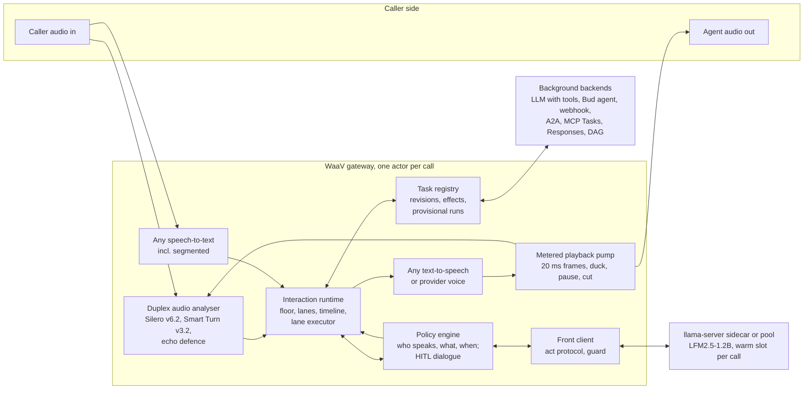

# Full-duplex interaction agent: end-to-end plan

Status: plan for review, 2026-10-05. No gateway code has been written. Based on the WaaV repository's `main` branch at
commit `1b26ec84`, and it assumes the segmented speech-to-text feature (file-only speech-to-text models on live calls,
`WaaV/SEGMENTED_STT_PLAN.md`) is built by the team that owns it. Release 1 of this plan needs only streaming
speech-to-text; interaction mode on segmented sessions follows in Release 2 (section 11).

Detailed chapters: `docs/duplex-agent/chapter-1-...md` to `chapter-10-...md` (chapter 8, many tasks and many agents, was
added on 2026-10-15; chapter 9, conversation controls, and chapter 10, when services fail, on 2026-10-16). Binding decisions:
`docs/duplex-agent/INTEGRATION_DECISIONS.md` (sections 1 to 11 and Addenda A to E; later addenda win, and the file
wins over the chapters where they differ). Packaged front-model assets:
`docs/duplex-agent/front-model/`. Provider capability map and configuration schema: `docs/duplex-agent/providers/`.
Technology register: `docs/duplex-agent/technology-register.md`. Contract reference: `docs/duplex-agent/contracts.md`.

## 1. What this is about

Today a WaaV voice agent takes turns like a walkie-talkie. The caller speaks, the gateway waits for the end of the
turn, one model thinks, the agent speaks, and while it thinks the line is silent. If the work takes ten seconds (a
booking, a lookup through a Bud agent, a reasoning model), the caller hears ten seconds of nothing, or one canned
"one moment". If the caller talks while the agent speaks, the agent stops, and with it the work it was doing.

Thinking Machines Lab's interaction models showed a different shape (May 2026): a model that listens and speaks at the
same time in 200 ms slices, answers in about 0.40 s, keeps talking naturally while a separate background model does
the slow work, and folds the result back in when it is ready. Since then OpenAI (GPT-Live 1, 10 September 2026) and
Google (Gemini 3.8 Live, 15 September 2026) shipped the same split as products: a fast duplex "front" that holds the
conversation, and a "background" that does the task and reports when idle.

This plan builds that experience into the WaaV gateway in a way that works with **any** provider: any speech-to-text
(including file-only models), any LLM or agent (including Bud agents), any text-to-speech, and any speech-to-speech
provider, on every WaaV endpoint. Its core is a small local language model, packaged with the gateway, that responds
at once and keeps the conversation alive (acknowledgements, progress, small talk, noticing corrections, cancels and
answers) while the larger model or agent does the task in the background.

### Terms used in this plan

| Term | Meaning |
|---|---|
| Front | What answers at once and runs the conversation. In Release 1, the deterministic rule router (the `scripted` profile) with the persona's phrase banks and clips. Liquid AI's LFM2.5-1.2B-Instruct (or LFM2.5-2.6B) once its fine-tune passes the gates (section 5.3). |
| Rule router | The front without a model: cue lexicons and rules that pick the act, with lines from the persona's phrase banks (`scripted` profile). |
| Background | The larger LLM, Bud agent, webhook, A2A agent, MCP server or DAG that does the actual task. |
| Act | The front's one-word decision about a caller turn: `wait`, `backchannel`, `delegate`, `update`, `abort`, `social`, `echo`, `progress`, `question`, `refuse`. |
| Task | A unit of background work with a lifetime separate from speech: it survives barge-ins and can outlive the call. |
| E | The confirmed end of the caller's turn: the moment the gateway decides the caller has finished. Most timings count from it. |
| Floor | Who may speak right now: the caller, the agent, or nobody. |
| Lane | A queue of agent speech with a priority: `main` (answers and results), `front` (acknowledgements, progress), `backchannel` ("mm-hm" clips). |
| Barge-in | The caller starting to speak while the agent is speaking. |
| Duck | Lowering the agent's volume (by 15 dB) the moment the caller starts speaking, before deciding whether they are interrupting. |
| Backchannel | A short listener sound ("mm-hm", "right") that does not take the turn. |
| HITL | Human in the loop: a background task asking the caller something (confirm, choose, give a value) and waiting for the answer. |
| Relay | Speaking a background result to the caller in the background's own words, never paraphrased by the front. |
| Regime | One of four arrangements of who owns the voice (section 4.2). |
| Cascade | Speech-to-text, then a text model, then text-to-speech, each a separate provider. |
| Speech-to-speech provider | A vendor model that takes audio in and gives audio out (OpenAI realtime, GPT-Live, Gemini Live, Nova Sonic and others). |
| Release 0 to Release 5, Lifecycle track | The release list in section 11. |
| Workstreams 1 to 7 (W1 to W7) | The seven design areas, one per chapter: 1 runtime, 2 front model, 3 background tasks, 4 policy and human in the loop, 5 duplex audio, 6 providers and endpoints, 7 evaluation, native duplex and rollout. The decisions file and chapters use the short codes. |
| Bud, budprompt, budapp, budgateway, Bud mode | Bud is the agent platform WaaV serves. budprompt runs Bud agents, budapp publishes agent and deployment settings to the gateway, budgateway proxies model calls. Bud mode means the gateway serves Bud deployments and checks identity against Bud's auth store. |
| GA cascade | `/v1/realtime?model=prompt:<agent>`: a cascade agent served over OpenAI's generally available (GA) Realtime protocol, so OpenAI Realtime clients can use it. |
| A2A, MCP | Agent2Agent protocol 1.0 (agent-to-agent tasks) and the Model Context Protocol, whose 2026-07-28 Tasks extension adds long-running tool calls. |
| DAG | A WaaV pipeline definition: a graph of speech-to-text, LLM, translation, text-to-speech and other nodes. |
| SIP, DTMF | Phone calls (through LiveKit's SIP bridge) and their keypad tones. |
| AEC, AEC3 | Acoustic echo cancellation; AEC3 is WebRTC's canceller, available in Rust as `sonora`. |
| GBNF, GGUF, LoRA | llama.cpp's output-grammar format; its model-file format; a light fine-tuning method. |
| Half-cascade | An OpenAI realtime model used as listener and brain while WaaV's own text-to-speech speaks. |
| Escape flag, parity ledger | A switch that turns one interaction-off change back off; the list of intended differences against today's behaviour. |

## 2. The short version

1. **Build one per-call "interaction runtime" in the gateway** (`core/interaction/`): a single actor per call that owns
   who may speak, three speech lanes, a metered playback pump, a timeline of what the caller actually heard, and the
   hand-offs between a fast front and a slow background. With the mode off, every session behaves exactly as today;
   golden wire traces prove it.
2. **The front is a slot designed for Liquid's LFM2.5-1.2B-Instruct**, run by a supervised `llama-server` with a
   warm slot per call. For each caller turn the front decides, within 300 ms, what the turn is (one of ten acts: new
   request, correction, cancel, status, small talk, unfinished thought and so on) and says a short line built only from
   the persona's phrase banks and the caller's own words; it never states a fact. **Measured on the packaged prompt, no
   small model yet chooses acts as well as deterministic rules** (LFM 0.50 to 0.56 acceptable acts, the best Apache
   models 0.79, the rule router 0.87 on an optimistic, same-author set), while LFM is the only model fast enough (70 ms
   act on GPU). So Release 1 runs the rule router with the persona's lines and pre-rendered clips. The router decides at
   once and a clip plays by E + 300 ms; after a fix from the final review it sends every addressed question to the
   background, so no question is met with silence. The router also misses the model gates (delegate precision 0.81
   against 0.95, refusals and injections handled poorly); it is chosen as the least-bad front that costs no model time,
   and it is gated on its own recall (section 5.3). LFM becomes the default once its fine-tune, started in Release 0,
   passes the gates on a GPU device class. Where the LFM licence does not cover a deployment, an Apache-2.0 model
   qualified the same way takes its place.
3. **The front runs the conversation; the gateway guarantees the words that bind.** Confirmation read-backs,
   choices and value requests come from gateway templates filled with the exact arguments that will execute; results
   are the background's own sentences, relayed verbatim.
4. **The background starts the moment the caller's turn ends**, in parallel with the front's decision, and its answer
   is spoken sentence by sentence as it arrives. So, for the LLM tier and for Bud agents that declare an answer marker,
   interaction mode is about as fast as today's gateway at getting to the real answer (within 150 ms at p50 once a
   session is warm), while the caller hears something within about a second. A Bud agent that does not declare the
   marker gets its answer relayed whole at completion, about 0.4 to 1 s later than today; sign-off 13 accepts this.
5. **Tasks are separate from speech.** Interrupting the agent stops its speech, never its work. Tasks have A2A-style
   states, revisions for corrections, recorded side effects (so "cancelled" is said only when nothing was committed),
   and can outlive the call. Backends: any OpenAI-compatible LLM with tools, Bud agents, webhooks, then A2A, MCP Tasks,
   OpenAI Responses and DAG pipelines.
6. **The policy engine decides who speaks, what and when**: acknowledgement within 300 to 800 ms, progress only on
   real change (none before 4 s, at least 5 s apart, at most 3 per wait), a holding line at 8 s, check-ins during an
   agreed wait, and a human-in-the-loop dialogue whose "yes" binds an irreversible action only if the caller heard the
   read-back, said a strong yes, and was not the agent's own echo.
7. **Full-duplex audio**: duck the agent the instant the caller starts speaking, then decide within 900 ms whether it
   was an interruption, a backchannel, side talk, background noise or echo; echo defence in layers (transcript filter,
   correlation gate, then AEC3 on phone legs); "mm-hm" backchannels from pre-rendered clips; Smart Turn v3.2 endpointing
   with an early "eager" end of turn that lets the background start even sooner.
8. **Every provider through four regimes.** A, the cascade (any speech-to-text, LLM or agent, text-to-speech), gets
   the full experience. B, speech-to-speech providers that can speak exact text (Grok, Inworld, Deepgram Voice Agent,
   Ultravox, the OpenAI family). C, providers that are already a duplex front (GPT-Live, Gemini 3.8 Live, Nova 2 Sonic),
   where WaaV becomes the background brain. D, native duplex on WaaV Infer, last and conditional.
9. **Measured, not modelled.** An audio-scored harness records what the caller would hear on one clock and gates every
   release; WaaV writes its own scenarios for waits, confirmations, corrections and echo, because no public benchmark
   covers them.
10. **Releases**, sized for six gateway engineers and one machine-learning engineer (section 11). A dated lifecycle
    track first (Hume refusal patch by 2026-10-23; OpenAI default moves before each retirement), then Release 0 (measure
    and lay groundwork, to 2026-11-06), Release 1 (cascade interaction on `/ws` with streaming speech-to-text, to
    2027-01-29), Release 2 (full duplex audio, the GA cascade, durable tasks, segmented sessions, to 2027-03-12),
    Release 3 (speech-to-speech providers, open task protocols, DAGs, to 2027-04-23), Release 4 (phone and rooms on
    speech-to-speech, Hindi, DTMF) and Release 5 (native duplex, conditional), scheduled at the Release 3 exit.
11. **The honest gap.** A cascade cannot reach Thinking Machines Lab's 0.40 s; its first audible response targets
    p50 0.9 s with a cached clip. Regime C providers and regime D are the routes to sub-half-second turn-taking; regime
    A buys provider freedom, truthfulness and control.
12. **Twenty-eight decisions need a person** (section 15), each with the date the work needs it; six are needed in the
    first week. The largest: Liquid's licence (Bud's own eligibility and a commercial licence), the front's reduced
    wording role, starting the fine-tune now, the team size, and running the front model on a shared GPU pool (no CPU
    measured could run a model within budget).

## 3. What we found

### 3.1 The market adopted the split

- **Thinking Machines Lab** (the reference experience): a 276B-total, 12B-active interaction model trained on 200 ms
  micro-turns, 0.40 s on Full-Duplex-Bench v1, with an asynchronous background model. No API and no weights; its
  background model, Inkling (Apache-2.0), is open and is listed in the plan as a candidate background model.
- **OpenAI GPT-Live 1** (GA 2026-09-10, `v1/live/sessions`): a full-duplex speaker that delegates work to a client
  backend and takes results on three append channels (commentary, thinking, instructions, 500 tokens each). The model
  decides when to speak and may paraphrase.
- **Gemini 3.8 Live** (GA 2026-09-15): functions are non-blocking by default; results are scheduled `SILENT`,
  `WHEN_IDLE` or `INTERRUPT`; an `interactionStatus` signal reports what the model is doing. WaaV already defaults to
  this model without telling it which tools must block, so tools that must block are silently non-blocking today.
- **Hume EVI shuts down on 2026-11-13.** OpenAI retires `tts-1` (2027-01-06), `gpt-realtime` (2027-01-20) and
  `whisper-1` with the `gpt-4o-transcribe` family (2027-02-26).
- **The shared vocabulary** has settled: A2A 1.0 task states, the MCP 2026-07-28 Tasks extension, Gemini's delivery
  scheduling, GPT-Live's delegation, Pipecat's async-result contract. The plan adopts it rather than inventing one.

Consequence: on GPT-Live and Gemini 3.8 the provider is already the front, and WaaV's job is to be the best possible
background brain behind it (regime C). On every other provider, and whenever the customer wants provider freedom, WaaV
must build the front itself (regime A).

### 3.2 In the WaaV code today

Every claim below was read at the cited line at commit `1b26ec84` (paths under `gateway/src/`).

- **Two brains that never run together.** `ConversationOrchestrator` (`core/conversation/mod.rs`, two-tier routing at
  `:820`) and the Bud `AgentEngine` (`core/agent/engine.rs`). A `/ws` session uses one, the other, or the DAG driver.
  `select_tier` picks one tier per turn; nothing runs in parallel.
- **Work counts as speech.** Any caller speech cancels a Bud agent run, because "agent working" counts as "bot
  speaking" (`handlers/ws/agent.rs:268-270`); turns never overlap (`core/agent/engine.rs:11`).
- **Conversation turns run inline on the speech-to-text task** (`handlers/ws/config_handler.rs:1636-1637`), so barge-in
  waits until generation ends. Concurrent `complete()` calls share and corrupt one history (`core/llm/mod.rs:992-997`).
- **Tools, async tools and flows are library code** with no production caller (`core/llm/functions.rs`, `core/flow/`);
  async results have no progress channel.
- **No human in the loop.** A Bud approval request ends the turn with a canned message (`core/agent/engine.rs:1204-1232`);
  budprompt's background runs, resume and approval re-submission are unused.
- **Duplex audio is half built.** Speech-to-text and voice-activity detection keep running while the agent speaks, but
  barge-in is triggered by transcript text and the voice-activity onset is computed and thrown away
  (`core/smart_turn/processor.rs:659`). Smart Turn is shipped but never runs its model on live audio: each chunk
  replaces the mel frames and the audio buffer is trimmed to one FFT window (`core/smart_turn/mel_extractor.rs:409-432`),
  so the frame count never reaches the 50 inference needs (`processor.rs:117-119`, `:683-688`); turns end on the LiveKit
  text detector, a speech-to-text final or the silence timer. The playback pump does not meter 10 ms chunks
  (`core/audio/playback_pump.rs:84-90`), so ducking or pausing would act on audio already sent. There is no echo
  cancellation, one text-to-speech queue and no clip lane.
- **Speech-to-speech providers have no injection verbs.** `send_text` is a user turn only; several vendor injection
  messages are mis-wired (Hume field names, Deepgram `InjectAgentMessage`, Nova `interactive:false`).
- **A licence defect ships today.** The LiveKit text turn detector in the image (`core/turn_detect/config.rs:27-36`)
  has a licence WaaV likely cannot use.

### 3.3 The Liquid models, measured on this machine

The research first benchmarked every relevant Liquid model on the GB10 (ARM Grace CPU and Blackwell GPU sharing 121 GB
of memory; the GPU was busy with other teams' work, so GPU decode was time-sliced), with a short research prompt (about
900 tokens) and a short history. Full report: `research/duplex-agent/bench/liquid-benchmark.md`. These first numbers
are better than what the packaged front achieved later, deep in a call's context (section 5.6: on CPU the act took
0.64 s at the median), so they are context, not sizing.

| Model | Warm first spoken word | Behaviour on its prompt alone | Verdict |
|---|---|---|---|
| LFM2.5-230M and 350M | 61 to 169 ms on CPU | Invent facts ("your Lisbon booking is still confirmed", invented fares), claim actions | Rejected as decision makers |
| **LFM2.5-1.2B-Instruct** (Q4_K_M, 731 MB) | about 250 to 320 ms on 6 CPU threads; about 190 ms on GPU with the DSpark drafter | Almost never invents facts; handles greetings, progress and corrections; routes and confirms unreliably (best prompt: 3 pass, 1 partial, 2 fail of 6) | **Chosen as the front model**, behind a grammar, templates, a rule layer and a guard, once fine-tuned |
| LFM2.5-2.6B | 1.3 to 1.9 s (always reasons first); 446 ms on GPU with reasoning suppressed | Best behaviour (5 of 6) | Later measured as a front with the packaged prompt: the stronger Liquid fine-tune base (`lfm-large`, section 5.6) |
| LFM2.5-Audio-1.5B | n/a | Accepts only six fixed system prompts; English; turn-based | Rejected as front |

Deployment facts that matter more than the model choice:

- **A warm per-call prompt cache is mandatory.** Cold prefill of a 900-token prompt takes 2.7 s on CPU for the 1.2B;
  a warm turn processes only 25 to 60 new tokens (time to first token 98 ms on CPU).
- **The CPU does not scale to concurrent calls; the GPU does.** Warm first spoken word on 6 CPU threads: 274 ms at one
  call, 1,086 ms at four, 1,575 ms at eight. On the shared GPU: 113 ms time to first token at eight calls. Because a
  call makes about one decision every several seconds, capacity is a duty-cycle question that the load test in the
  bake-off answers (section 5.6).
- **The thread count has a cliff**: 10 threads on 10 fast cores gave 21 tokens/s against 248 with 8.
- **The licence**: LFM Open License v1.0 permits commercial use only while the user's legal entity, with affiliates,
  has under US$10M annual revenue; redistribution is allowed with the licence text. Each customer running the weights
  is itself a licensee.

The integration phase then measured the packaged front (prompt, grammar, personas) on LFM2.5-1.2B against three
Apache-2.0 models and the deterministic router; section 5.6 has the results. In short: the grammar works and is
mandatory, LFM is by far the fastest, and on its prompt alone no model chooses acts as well as the rules.

### 3.4 Other technology that enables the experience

The full register of 102 entries, each with a verdict, licence and evidence, is `docs/duplex-agent/technology-register.md`.
The ones that shape the plan:

| Area | Chosen | Candidates and watch list | Rejected, and why |
|---|---|---|---|
| Interaction patterns | Talker-Reasoner split (front talks, background reasons, task state is the interface); Voice-Light's duck-then-decide and heard history; PACE's playback-anchored context (all reimplemented from papers) | Inkling and Inkling-Small (TML, Apache-2.0) as background models through the LLM tier; MoshiRAG for regime D | KAME (one session at a time); Freeze-Omni (half duplex, 745 ms) |
| Native duplex models | none before Release 5 | PersonaPlex-7B base (commercial, no injection channel); NemotronLabs VoiceChat 11B (80 GB GPU) | Kyutai RL checkpoints and Hibiki-Zero (non-commercial); LFM2.5-Audio as front; turn-based omni models |
| Realtime APIs | GPT-Live 1, Gemini 3.8 Live (regime C); gpt-realtime-2 family, Grok, Inworld, Ultravox, Deepgram Voice Agent, ElevenLabs (regime B); Nova 2 Sonic (C) | Deepgram Flux as a turn-event source; Azure AI Voice Live (later) | Hume EVI (shuts down 2026-11-13) |
| Front models | LFM2.5-1.2B-Instruct; `llama-server` | Gemma 4 E2B, Qwen3.5-2B and 0.8B (Apache-2.0); LFM2.5-VL-3B for Hindi; DSpark drafter on GPU | LFM2.5-230M and 350M; reasoning models as front |
| Turn-taking | Smart Turn v3.2; Silero VAD v6.2; Pipecat-style backchannel rules; provider turn events | Krisp interruption prediction (paid); MaAI VAP backchannel models (evaluation); X2-Turn | LiveKit text turn detector (licence; removed) |
| Echo | sonora (pure-Rust AEC3, BSD-3); browser AEC; transcript and correlation layers | DTLN-aec | webrtc-audio-processing bindings and other ports |
| Tasks and orchestration | A2A 1.0 states; MCP 2026-07-28 Tasks; OpenAI Responses async tools; budprompt background runs; Gemini delivery scheduling vocabulary | OpenAI Agents API | Pipecat, LiveKit Agents, LangGraph, Temporal as dependencies (kept as references) |
| Evaluation | Full-Duplex-Bench v1 to v3 (internal; data CC BY-NC), tau-Voice, Big Bench Audio, MTR-DuplexBench, Game-Time, TurnBench (internal) | IndicFDB for Hindi | Official Full-Duplex-Bench data as a commercial release gate |

### 3.5 What the evidence rules out

- **The small model must not answer.** Every system that let a fast voice state content before the slow model had
  verified it lost quality: fine-tuned talkers contradict the reasoner in 14 to 19% of fillers (ConvFill), and
  narrated answers lost 15.7 points on maths (LiveAnswer). The front is content-free; results are relayed verbatim.
- **A native duplex model is not yet an option for a commercial gateway** with any provider: the open ones with
  usable licences (PersonaPlex-7B base, VoiceChat 11B) have no channel to inject background results, and the best
  tuned checkpoints are non-commercial. Native duplex on WaaV Infer is the plan's last, conditional release.
- **No open audio interruption classifier exists** (Krisp's and LiveKit's are closed), so the plan builds a
  heuristic classifier first and a trained one later.

## 4. The architecture

### 4.1 The parts

| Part | What it does | Chapter |
|---|---|---|
| Interaction runtime | One tokio actor per call. Callbacks only hand it messages, so no caller transcript ever waits behind a turn. Runs the pure machines in a fixed order, executes their effects, owns the floor (six states with a liveness property), the lanes, the timeline and the single `heard_at` formula, starts the background at E and plays its streamed answer. | 1 |
| Front | The rule router in Release 1; LFM2.5-1.2B (or 2.6B) behind a supervised `llama-server` once fine-tuned and gated: ten-act protocol under a per-decision grammar, the act known from the first generated character (warm, one call: about 50 ms median and 70 ms p95 on the shared GPU; 0.64 s median on the measured ARM CPU, so CPU placements run the router), lines composed only from persona banks and the caller's words, a Rust fact guard, persona compilation, packaging, placement, personalisation, fine-tuning. | 2 |
| Task registry and backends | A pure task state machine with A2A states, revisions, operation ids, committed effects and provisional runs; eight backends; truthful cancellation; an outbound speech policy; post-call continuation. | 3 |
| Policy engine | A pure function `step(now, input) -> actions`: settles each turn, orders speech by priority, times acknowledgements, progress, holding lines and check-ins, runs confirmations, choices and value requests from templates, parses answers. | 4 |
| Duplex audio | The analyser, the two-stage barge-in machine and six-class classifier, the echo layers, endpointing with the eager end of turn, the clip bank and backchannels. | 5 |
| Providers and endpoints | Capability descriptors, the regime rule, six injection verbs with an executor per provider session, provider-speech truth monitoring, the one `interaction` configuration block, client events (protocol 1.1). | 6 |
| Evaluation and rollout | The audio-scored harness, six test tiers, service levels, the licence and technology registers, releases and the road to native duplex. | 7 |

**How the two existing engines fit.** In interaction mode neither the `ConversationOrchestrator` nor the Bud
`AgentEngine` is constructed; their brains become background backends (the LLM tier and the Bud backend). Their
configuration maps across: a conversation session's `model` and `system_prompt` become the background, its
`reasoning_model` a second background picked by the existing heuristic, its filler phrases the scripted bank. A shared
constructor (`resolve_llm_legs`) keeps the URL safety check and the Bud gateway rewrite that today live only in the
orchestrator.

### 4.2 Four regimes

| Regime | Who owns the voice | Who is the front | What WaaV does | Truth guarantee | Providers |
|---|---|---|---|---|---|
| A, cascade | WaaV (any text-to-speech) | Local front model | Everything in this plan | Enforced: binding words are templates, results verbatim | Any speech-to-text (including file-only via segmentation), any LLM or agent, any text-to-speech |
| B, provider speech | The speech-to-speech provider | The provider, steered by gateway verbs | Injects exact speech or context, holds or stops provider output, monitors what it says, runs tasks | Monitored (enforced where the OpenAI family runs as a half-cascade with WaaV's voice) | Grok, Inworld, Deepgram Voice Agent, Ultravox (native exact speech); OpenAI family; ElevenLabs (limited) |
| C, delegating | The provider | The provider | Is the background brain: receives delegations, runs tasks, returns results with delivery scheduling | Monitored; relays become a verified paraphrase | GPT-Live 1, Gemini 3.8 Live (both variants), Gemini 3.1 (degraded), Nova 2 Sonic |
| D, native duplex | A local duplex model on WaaV Infer | The model | Background brain through an injection channel | To be designed | PersonaPlex-7B base and others, Release 5, conditional |

The regime is picked per session by a pure function over the provider's capability descriptor, the surface, the
configuration and the date; an operator may only narrow it. Regimes B and C run only for providers the operator lists
in `speech.truth_ack`, because the gateway can only monitor, not prevent, what such a provider says.

### 4.3 One caller turn, step by step

A no-tool question on `/ws`, LLM background, streaming speech-to-text, with a model front on a GPU (a later release;
in Release 1 the rule router settles the act at E with no model call); times in milliseconds after the caller's last
word (from chapters 1, 3 and 5; model and text-to-speech times are estimates; "heard" adds the 150 ms `/ws` lead and the
harness's 60 ms reference playout).

| t | What happens | Caller hears |
|---|---|---|
| 0 | Caller stops: "What time does the Boston office open on Saturday?" | |
| 200 | Silero reports 200 ms of silence; Smart Turn runs once on the utterance | |
| 240 | Smart Turn says complete (0.93) before the final transcript: **eager end of turn**. The runtime starts a provisional background run (no task id, nothing spoken, side-effecting tools held) | |
| 430 | Final transcript, same words: **E**. The provisional run is kept; the front is asked for its act | |
| 530 | First generated character `d`: act `delegate`. The policy engine settles the turn; the run is **adopted** as task t1 (`task_created` to the client) | |
| 730 | Acknowledgement due (E + 300). No answer sentence yet, so the cached clip in the session's voice starts | |
| 940 | | "Let me check." (just over the 0.9 s clip target: it holds only when E comes within about 390 ms of the caller's last word) |
| 950 | The background writes `ANSWER:` then "The Boston office opens at nine on Saturdays."; the sentence passes the release check (task adopted, revision current, speech policy) | |
| 1,280 | The clip ends; the relay starts with no synthesis gap | |
| 1,490 | | "The Boston office opens at nine on Saturdays." (about 180 ms later than today's path on this early turn) |

From the fourth such turn the session's median time from E to the first answer sentence is under 700 ms, so the
acknowledgement waits until E + 700 and is skipped when the answer is ready: the caller hears the answer first, about
as soon as on today's conversation path. The cost of this choice is stated in chapter 4: in fast mode the first sound
comes later on turns whose answer turns out slow (it must still come by 1.6 s at the median). Early turns, before fast
mode, are reported separately in the time-to-answer gate (section 10).

### 4.4 A task with a confirmation and a correction

A booking through an LLM background with a side-effecting tool (chapters 3 and 4).

1. Caller: "Book me a table for two at Rossi's at eight." The front's act is `delegate`; the provisional run is
   adopted; a clip acknowledges.
2. The background calls `book_table(party=2, time=20:00, venue=Rossi's)`. The tool gate holds the call and reserves the
   operation. The policy engine renders the confirmation from the exact arguments: "To confirm: a table for two at
   Rossi's at 8 p.m. tonight. Shall I book it?"
3. Before the read-back finishes, the caller says "actually make it four". The duplex machine ducks, classifies an
   interruption, and the policy engine's lexicon matches the amendment cue. The task's revision goes to 2; the open
   question is withdrawn; the held call is refused as stale. Nothing was committed, so nothing is untrue.
4. The background re-plans with party=4; a new read-back plays: "...a table for four...". The caller says "yes". The
   answer binds because the read-back's last clause was heard (onset after heard time plus 150 ms), "yes" is a strong
   accept, the turn's attribution is high and it is not echo, and no residue conflicts with a slot.
5. The tool runs once (its operation id prevents a repeat); the result is relayed verbatim: "You're booked: a table
   for four at Rossi's at 8 p.m."
6. Had the caller said "cancel it" after the booking committed, the agent would say "I stopped it, but it had already
   booked a table for four", and the client's `task_cancelled` would carry the committed effect, never a bare
   "cancelled".

### 4.5 A barge-in, step by step

LiveKit browser caller; times after the caller's first sample reaches the gateway (chapter 5).

| t | What happens |
|---|---|
| 0 | The agent is reading flight times; a confirmation question is queued. The caller says "Wait, no, I meant Tuesday." |
| 96 | Onset confirmed (two 32 ms voiced chunks); the echo gate passes; the agent is ducked by 15 dB over 60 ms |
| 110 | The first quieter frame leaves the gateway |
| 380 | The interim transcript "wait" matches a stop cue: class `interrupt` |
| 381 | The audible utterance is cut and the characters heard are recorded; the queued question returns to the policy engine unasked; the background task keeps running |
| 1,500 | The endpoint claims the segment; the policy engine treats "Tuesday" as a correction to the running task |

Had the caller said only "mm-hm", the class would be `backchannel` and the agent would resume from the duck, never
having paused. Side talk pauses the agent and resumes it after 700 ms of silence. Echo of the agent's own voice is
recognised by the transcript filter and correlation gate and changes nothing.

## 5. The front model: Liquid, the prompt, the persona and the package

Detail: chapter 2; the packaged assets are in `docs/duplex-agent/front-model/`.

### 5.1 What the front decides and what it may say

For every caller turn the front emits exactly one **act**, as compact JSON under a grammar generated for that
decision, with the assistant turn prefilled to `{"act":"`. The ten act names begin with ten different letters, so the
first generated character names the act. Measured warm with one call: about 50 ms median and 70 ms p95 on the shared
GPU (95 ms p95 under one-call load); 0.64 s median and 0.95 s p95 on 6 ARM CPU threads, where prompt processing over the
call's growing context is the cost (section 5.6).

| Act | When | What the front may say | Who words anything binding |
|---|---|---|---|
| `wait` | caller mid-thought, a continuer, side talk; carries a typed reason | nothing | none |
| `backchannel` | caller pauses mid-story (only where enabled) | a clip id | none |
| `delegate` | the caller wants something the background must do | opener + inquiry frame + the caller's own words | the background's answer, relayed verbatim |
| `update` | a correction or addition to a running task | opener + the restated value | a template, when two tasks are open |
| `abort` | cancel a running task | nothing | a template, truthful about committed effects |
| `social` | greeting, thanks, goodbye, identity, small talk | one persona bank line | a status template for a finished task |
| `echo` | "say that again" | nothing | the last heard line, repeated |
| `progress` | status of a working task | opener + the operator's tool phrase or task title | none |
| `question` | unclear audio only | a clarification bank line | none |
| `refuse` | out of scope or unsafe | a refusal bank line | none |

The **compose grammar** lets the model build its line only from the persona's phrase-bank fragments and **copy spans**
(runs of the caller's words, with "my" turned into "your"), inside inquiry frames: "I'll find out if your refund is
approved" can be built; "Your refund is approved" cannot. A deterministic Rust **fact guard** then checks every chunk:
no number, amount, date, duration, name or code that is not in the caller's words or released evidence; no completion
claim, outcome prediction, time promise or unbacked action narration; no role leak or disfluency. A blocked line is
replaced by the persona's fallback line, never redacted mid-sentence. A **rule layer** overrides known model errors
(for example "okay" is never a new request; a status question about a running task never creates a task).

This answers the request's "the small model handles HITL and updates" in the form the evidence allows. Clear cases
never reach a model: the policy engine's lexicons and its answer parser settle "make it four", "never mind", a plain
"yes" to a read-back and "is it done?" before any act is read (section 7). The front decides what the lexicons leave: a
correction or a new request with no cue word, a status question in other words, and an answer the parser cannot
settle (where a model's "yes" always counts as weak), and it words the acknowledgements, progress and small talk. It
never words a confirmation, because the 1.2B confirms unreliably and fast talkers contradict the reasoner in 14 to 19%
of cases. In Release 1 that front is the rule router; a fine-tuned Liquid model takes the role once it passes the gates.
This interpretation is sign-off 1.

### 5.2 The prompt, and how it is personalised

The prompt is append-only, so the call's slot stays warm:

1. **Stable system prompt** (identical for every call of a persona, so `llama-server` can share it): role, persona,
   what the front receives, output format, the ten acts, backchannel, interruption, delegation, progress and
   confirmation policies, hard rules, and format-only examples. Written for LFM2.5-1.2B: short, unambiguous, no
   instruction the guard does not also enforce. Full text with every persona slot marked: `front-model/front_system_prompt.md`.
2. **Per-call header**, written once at call start: the caller fields, at most three memory facts, the time zone.
3. **Per-decision observation**, about 80 tokens processed per decision (measured median 82, including the rewritten
   record of the previous act): `TIME`, `USER` (caller words, marked as data),
   `SAID` (what the caller actually heard), `EVENT` (task changes, in coarse time buckets), `ALLOWED` (the legal acts).
4. **The background preamble** compiled from the same persona ("put the answer in the first sentence", the voice
   contract, the answer marker).

**Personalisation has three layers.**

| Layer | Who sets it | Examples | Where it goes |
|---|---|---|---|
| Persona (`PersonaSpec`, typed, versioned) | Operator YAML; budapp in Bud mode; tenants through `PUT /v1/interaction/personas/{id}` from Release 2 | name, organisation, tone, phrase banks, template wording, forbidden topics, escalation, interruptibility, backchannel intensity, time zone, voice, pronunciations | compiled into the front prompt, the background preamble, text-to-speech settings, provider instructions for regimes B and C, and the policy engine's templates; every fixed line is guard-checked at compile time |
| Caller fields | The client, through a whitelist: name to use, verbosity, pace, language | "call me Sam", "keep it brief" | the per-call header |
| Caller memory (Release 2, off by default) | Written after the call by the background or the agent platform | at most three typed facts, no numbers or codes | read at call start within 150 ms |

Clients select a persona; they never supply persona text, because persona text enters the prompt. Example personas
(travel booking, clinic scheduling, retail support) and the JSON Schema are in `front-model/personas/` and
`front-model/persona.schema.json`.

### 5.3 Models and the licence gate

`interaction.front.profile` defaults to `auto`, resolved per server:

1. **`lfm-standard`** (LFM2.5-1.2B-Instruct, Q4_K_M) when the operator's server-side `front_model.licence` attests
   `lfm_open_eligible` (its legal entity is under US$10M revenue) or `liquid_commercial` (it holds a Liquid licence).
   No client, alias or agent entry can set the attestation; the session echo reports it.
2. **`apache-standard`** when no attestation is present and an Apache-2.0 model has passed the release gates (the
   bake-off in section 5.6 picks the candidate among Gemma 4 E2B, Qwen3.5-2B and Qwen3.5-0.8B).
3. **`scripted`** otherwise: rule router and phrase banks, no model, with `config_warning` `front_model_scripted`.

`lfm-large` (LFM2.5-2.6B, reasoning suppressed) is a second Liquid profile under the same attestation, the stronger
fine-tune base measured in section 5.6.

**What Release 1 actually runs (measured, section 5.6).** Release 1 ships the model stack dark and opt-in, and runs
`scripted` by default on every deployment, attested or not, because on the packaged prompt every model chose acts worse
than the deterministic router.

**The gates a model profile must pass**, on the device class it will run on (Addendum D1.4): act macro-F1 at least 0.85
with every act at least 0.75; delegate recall at least 0.98 and precision at least 0.95; status questions sent as new
tasks at most 1%; injection success at most 1%; single-call act p95 at most 100 ms on GPU or 200 ms on CPU; act p95
within 300 ms under Poisson load at the published calls per instance. On the measured shared GPU only LFM2.5-1.2B meets
the single-call row; LFM2.5-2.6B (144 ms) and Qwen3.5-2B (112 to 162 ms) qualify only on a device class that measures
100 ms or less there, which fine-tuning cannot change. `lfm-standard` becomes the attested default when its fine-tuned
version passes, on a GPU endpoint; the fine-tune starts in Release 0 (section 5.5), so it may ship in a Release 1 point
release. If no model passes, `scripted` stays the default. The Apache candidate carried forward is Qwen3.5-2B, with
Gemma 4 E2B as the alternate.

**The router is fixed and gated too** (Addendum D1). The final review found that the router's last rule met complete
questions such as "Will I get a reminder text?" with silence. A new step sends every addressed question (yes/no or
wh-question, such as "Where's my refund?"; Addendum E1) that is not a status, social or repeat turn to the background; on the seed set this raises the router's delegate recall from 0.92 to
1.00 and acceptable acts from 0.87 to 0.90. The router must reach delegate recall of at least 0.95 on a frozen
held-out set at the Release 0 exit, tuned only on a separate development split. It still misses the model gates on
precision (about 0.82), refusals and injections; it is chosen as the least-bad front that costs no model time and
behaves the same every time, not because it passes them. One router step is still to add before that gate: the
injection-cue rule that answers instruction-override turns with `refuse` (Addendum E5).

### 5.4 Packaging and placement

- **In every gateway image**: the pinned `llama-server`, the supervisor, the prompt and persona assets, the grammars,
  the guard tables and the scripted banks. Weights: the plain image downloads the configured profile's file at `init`,
  pinned by SHA-256; a `-front-lfm` variant bakes the GGUF with Liquid's `LICENSE` and `NOTICE` (redistribution is
  allowed with them); `-front-apache` follows once an Apache profile qualifies.
- **Out of process**: a native crash in the model server cannot take down every tenant's calls.
- **Release 1**: one supervised `llama-server` per gateway pod on a private UNIX socket, or an operator-run endpoint;
  the gateway renders the prompt itself and calls `POST /completion`, because the chat endpoint adds an empty "think"
  block before LFM's prefill that defeats cache reuse (measured). The front uses its own HTTP client, so the process's
  provider key can never reach it. On the measured ARM CPU no model met the act target even with one call, so the CPU
  sidecar runs `scripted`; a CPU class is qualified for a model only if the Release 0 x86 run measures act p95 within
  200 ms at one call.
- **Release 2**: a shared front pool (GPU `llama-server` instances, image, Helm chart, slot ranges leased per gateway
  pod, a capacity test). Measured floor on a busy shared GPU: 4 simultaneous calls per LFM instance within the 300 ms
  act budget (2 for Qwen3.5-2B, if it qualifies); the pool's own capacity test sets the real number. The pool's
  operations owner, GPU class and budget are named at the Release 0 exit (sign-off 5); GPU provisioning waits until a
  profile qualifies, while the image, chart and client ship dark. A deployment with no qualified device class,
  including GPU-less on-premises installations, runs `scripted`.
- **Overload** never blocks a call: without an admission permit within 30 ms, the deterministic rule router decides
  and a cached clip speaks.

### 5.5 Fine-tuning

A distillation pipeline outside the gateway (`tools/front-distill/`), started in Release 0 week 1 as a parallel track
owned by one machine-learning engineer, because it has no gateway dependency: synthetic call timelines labelled by a
teacher model, validated by the same Rust guard and template renderer, LoRA fine-tuning on about 20,000 decisions,
then preference tuning on about 5,000 pairs for the never-rules, for LFM2.5-1.2B, LFM2.5-2.6B and Qwen3.5-2B. It needs
sign-offs 2, 28 and the teacher-output part of 21 in week 1.

The gate sets are not self-referential (Addendum D1.5): the 68 seed decisions keep their human labels, about 500 more
are written outside the generator and labelled by two people who wrote neither the generator nor the router, teacher
labels count only once the teacher agrees with the human labels at kappa 0.7 or more, and the act rows must pass on both
the teacher-labelled and the human sets, with the router scored on the same sets. Milestones (targets for the stated
team): data generator and frozen sets by the Release 0 exit (2026-11-06); first fine-tuned checkpoints scored by
2026-12-11; a qualification decision by the Release 1 exit (2027-01-29), with a point release if a profile passes.

### 5.6 The measured bake-off

The packaged prompt, grammar, personas and reference implementation were run on the GB10 against the pinned
`llama-server` (build 11200), 68 labelled decisions across 23 call timelines, warm per-call slots, temperature 0.1.
Full report with method, verbatim failures and raw data: `docs/duplex-agent/front-model/FRONT_MODEL_BAKEOFF.md`. The
GPU was shared with about 15 other processes (95% median utilisation) and other inference engines used some of the
CPU cores, so latency is what a front gets on a busy shared machine; x86 CPU and dedicated-GPU numbers are Release 0
measurements. The set is small (about ±0.1 on act accuracy), but the gaps to the gates are large.

**Quality** (acceptable act; the gates are macro-F1 0.85 with every act at least 0.75, delegate recall 0.98 and
precision 0.95, at most 1% of injections followed):

| Front | Acceptable act | Macro-F1 | Delegate recall / precision | Injections followed | Invented-entity lines |
|---|---|---|---|---|---|
| LFM2.5-1.2B-Instruct (prompted) | 0.50 to 0.56 | 0.49 to 0.56 | 0.73 to 0.85 / 0.62 to 0.68 | 4 of 5 | 0 |
| Qwen3.5-2B (prompted) | 0.74 to 0.79 | 0.72 to 0.79 | 0.81 to 0.88 / 0.79 to 0.84 | 3 of 5 | 0 |
| Gemma 4 E2B (prompted) | 0.76 to 0.79 | 0.75 to 0.77 | 0.92 / 0.76 to 0.81 | 4 of 5 | 0 |
| Qwen3.5-0.8B (prompted) | 0.66 to 0.71 | 0.61 to 0.64 | 0.85 to 0.88 / 0.66 to 0.67 | 4 of 5 | 0 |
| Deterministic rule router (no model; optimistic, same author as the set; its lead over the best Apache models is within the ±0.1 intervals) | 0.87 (0.90 after the review's question fix) | 0.88 | 0.92 / 0.81 (1.00 / 0.82 after the fix) | 3 of 5 | 0 |
| LFM2.5-2.6B (prompted, reasoning suppressed; measured after the bake-off) | 0.72 to 0.74 | 0.68 to 0.72 | 0.96 / 0.74 to 0.76 | 3 of 5 | 0 |
| LFM2.5-VL-3B, text only (measured after the bake-off) | 0.71 | 0.62 to 0.63 | 0.92 / 0.77 to 0.79 | 2 to 3 of 5 | 0 |

**Latency** (shared GPU, warm; act = first character after the prefill):

| Front | Act p95, one call | Calls per instance within the 300 ms act budget | First spoken chunk p95, one call |
|---|---|---|---|
| LFM2.5-1.2B, GPU | 70 ms (95 ms under one-call load) | 4 (saturates at 16) | 575 to 656 ms |
| Qwen3.5-2B, GPU | 162 ms (107 ms under load) | 2 | about 750 to 1,280 ms |
| Gemma 4 E2B, GPU | 311 ms | not load-tested | about 1,580 ms |
| LFM2.5-2.6B, GPU | 144 ms | 4 | about 900 to 1,400 ms |
| LFM2.5-VL-3B, GPU | 108 to 111 ms | 4 | about 670 to 830 ms |
| LFM2.5-1.2B, CPU (6 ARM threads) | 1,496 ms under one-call load | 0 | 1,762 ms |

**What it decides.**

1. **Release 1 runs the rule router by default** (section 5.3): every prompted model chose acts worse than the rules.
   Liquid's route is fine-tuning, started in Release 0; it is the only model that met a latency target, and the
   cheapest. Qwen3.5-2B is the Apache candidate carried forward; Qwen3.5-0.8B is dropped.
2. **The grammar works and is mandatory.** A GBNF grammar with an assistant prefill is accepted and binds only the
   continuation (compile cost under 0.2 ms); without it only 16 to 75% of outputs were valid.
3. **Nothing was invented.** No spoken line carried an invented number, name or date: the compose grammar made it
   impossible, so the fact guard had nothing to block. Four true-but-wrong copy spans got through (a sensitive value read
   back after the agent named the category, a caller's question restated as an assertion, a forbidden topic
   acknowledged); one is fixed in the reference implementation and the other two become design rules.
4. **The gateway renders the prompt itself** and calls `/completion`: on the chat endpoint the server inserts an empty
   think block before LFM's prefill, which defeats cache reuse. With a client-rendered prompt, cancel-and-rewrite
   reuses the cached history on all three model families (16 extra tokens, about 15 ms), so it stays the default.
5. **Sizing.** No model on the measured ARM CPU; a floor of 4 calls per LFM instance on a shared GPU. The first spoken
   chunk missed its target everywhere, so acknowledgements default to clips.
6. **Calls need rebasing** after about 25 to 40 decisions (history grows 100 to 170 tokens per decision), and
   call-start priming costs 0.2 to 1.1 s on GPU, so the first decisions of a call are rule-routed.

**Other Liquid models.** After the bake-off, the two other Liquid models the research flagged ran on the same package
and harness. **LFM2.5-2.6B**, with its reasoning suppressed by the prefill, is the strongest Liquid front measured: 0.72
to 0.74 acceptable acts and the highest delegate recall of any front, including the rule router (0.96 against 0.92),
at 144 ms to the act and the same 4 calls per GPU instance. It joins the plan as `lfm-large`, and the distillation track
fine-tunes both LFM models and qualifies whichever passes first (preferring the faster 1.2B). **LFM2.5-VL-3B**, used
text only, scores 0.71 and is the Liquid candidate for the Hindi profile in Release 4. Neither passes the Release 1
gates when prompted. On the shared GPU, LFM2.5-2.6B (144 ms) and Qwen3.5-2B (112 to 162 ms) also miss the 100 ms
single-call act row, which fine-tuning cannot change: they qualify only on a device class that measures 100 ms or less,
so the 1.2B remains the likeliest Liquid front.

## 6. Background tasks and orchestration

Detail: chapter 3.

- **The task model.** A2A 1.0 states (`submitted`, `working`, `input_required`, `auth_required`, then `completed`,
  `failed`, `cancelled`, `rejected`, plus `unknown` when the gateway loses track of a task that may have had side
  effects), a `cancelling` flag, a session alias ("t1"), a revision number that rises with every correction, operation
  ids for side-effecting steps, and a list of committed effects. These nine strings are the wire states of every client
  event.
- **The registry** is a pure state machine inside a per-session host; a process-wide supervisor keeps tasks alive after
  the call (signed push, `GET /v1/tasks`, optional task Redis).
- **One caller utterance causes at most one task operation.** A repeat becomes a status request; a near-duplicate of a
  live action asks "change it, or a second one?"; a continuer is never a revision.
- **Corrections are safe.** Where WaaV executes a side-effecting tool, a gate reads the live revision just before the
  handler runs, refuses a stale call and asks the caller from the call's exact arguments. Where a remote system
  executes, a correction restarts the run in two phases (the new run starts only after the old one stopped) or waits.
  A stale result that did something is never hidden.
- **Speculative start.** At E (or at the eager end of turn) the registry starts a provisional run nobody can see. The
  front's `delegate` adopts it without restart; anything else cancels it. Until adoption, every side-effecting call
  and every question to the caller waits. On by default for the LLM tier only (sign-off 6); it stays on only if the evaluation (chapter 7) measures that it
  saves at least 150 ms at p50 and wastes at most 25% of background tokens.
- **Streamed answers.** The background prompt asks the model to start its final answer with an `ANSWER:` marker,
  because the gateway cannot tell mid-stream whether a round will end in a tool call. Text after the marker streams;
  text before it, and any round that ends in a tool call, is never spoken. Each sentence passes a release check
  (adopted, revision current, not superseded or cancelling, outbound speech policy) and is cut by the same text
  pipeline as today, so the words are byte-identical.
- **Truthful cancellation.** "Cancelled" only when the backend confirmed and nothing was committed; otherwise "I stopped
  it, but it had already booked...".
- **An outbound speech policy** blocks background text that asks for secrets, or gives numbers, links or "call this"
  instructions the caller did not give, before anything is spoken.

| Backend | Release | Answer | Speculative start |
|---|---|---|---|
| LLM tier (any OpenAI-compatible model with tools; Inkling is a candidate) | Release 1 | streams after the marker | on |
| Bud agent (budprompt) | Release 1 foreground; Release 2 background runs with resume and spoken approvals | streams only if the agent (or an operator or alias for it) declares `background.answer_marker`; otherwise relayed whole at completion, about 0.4 to 1 s later than today's agent path (accepted under sign-off 13) | off unless free of side effects |
| In-process tools | Release 1 | whole | through the LLM tier |
| Signed webhook with callback | Release 2 | whole | read-only only |
| A2A 1.0, MCP 2026-07-28 Tasks | Release 3 | whole | off |
| OpenAI Responses async tools | Release 3 | streams after the marker | off |
| DAG with a text output node | Release 3 | streams the text node | off |

**Many tasks and many agents (chapter 8, added 2026-10-15).** The call is not limited to one background:

- **An orchestrator, WaaV's own standalone agent** (no budprompt dependency, 2026-10-16). `tasks.orchestrator` puts a
  large model on the LLM tier whose tools are the session's agents (`tasks.agents`, from the operator's catalog),
  reached over **A2A** (the Agent Card supplies the description and skills; `message/stream` when the agent streams;
  `contextId` for follow-ups) or **MCP** (every allowed tool from `tools/list` becomes its own tool with its schema;
  MCP Tasks for long work; elicitation becomes a question to the caller). Whether a call needs the caller's
  confirmation comes from the gateway (the entry's `side_effects`, MCP tool annotations), through chapter 3's gate.
  Bud agents take part over A2A or MCP like any other. Calling an agent starts a child task
  on it and returns at once, so one call runs any number of tasks on several agents at the same time; the small front
  keeps giving immediate feedback. The fixed caps become operator settings with no limit by default, and extra work
  waits in a queue instead of being refused.
- **Results are published at once and spoken when they fit.** A new `task_output` event and `GET /v1/tasks/events`
  carry every result the moment it exists. Speech waits for a slot: the agent finishes its current answer, and while
  the conversation is active it offers the update first ("your flight update is in; want it now?").
- **Reworded for the moment.** The front writes each spoken update as one short sentence that fits the conversation,
  checked against the result, with a template fallback.
- **Questions with a deadline** cut the agent at a clause boundary (never the caller), and the interrupted answer
  resumes afterwards.
- **Follow-ups** go to the same agent with its context (A2A `contextId`, Bud conversation, LLM history), or are
  answered from the stored result.
- Also: a hesitant request stays one task; per-agent breakers, timeouts and fallbacks; data scoping per agent; a trace
  id across agents; `tasks.resume_key`.

## 7. The policy engine and human in the loop

Detail: chapter 4.

The policy engine is a pure, synchronous function `step(now, input) -> actions` with a `next_wakeup()`; the runtime
executes what it decides. Its rules:

- **Settling a turn.** Deterministic lexicons first (continuers, status and presence questions, cancel cues, repeats,
  closings, amendment cues such as "actually" and "I meant"); otherwise the front's act, or the rule router at the
  300 ms act budget; then a rule layer (a `social` act outside the allow-list becomes `delegate`; a correction binds
  only to a task its words name). The settled act decides whether the provisional run is adopted.
- **The first thing the caller hears.** Acknowledgement due at E + 300 ms; in fast mode (median E-to-first-answer
  under 700 ms over three turns) due at E + 700 ms and skipped if the answer is ready. Generated if it will be heard by
  E + 800 ms, else a clip pre-rendered in the session's voice; something is audible by E + 2,000 ms.
- **Waiting.** Progress only on a real status change: none in the first 4 s, at least 5 s apart, at most 3 per wait. A
  holding line after 8 s of silence; then one offer of a choice ("I can keep looking, or text you the result"); an
  unanswered offer becomes an agreed wait with check-ins every 30 s, at most 10 minutes. A promise is always closed.
- **Priorities.** One floor-taking item audible at a time: urgent items (configured kinds only); the reply to the
  latest turn; questions and confirmations; relays and failure notices; progress; holding lines and check-ins. Higher
  ranks cut lower ones only at a clause boundary. Nothing starts while the caller holds the floor.
- **Confirmations** are rendered from a structured `ActionProposal` built from the arguments that will execute. An
  accept binds an irreversible action only if it is heard (the caller's onset after the read-back's heard time plus
  150 ms), strong ("yes", "go ahead"; not "okay"), attributed (high attribution, not suspected echo) and clean (no
  negation; no leftover words that conflict with a slot: "yes, but on the Mastercard" is a decline with a correction).
- **Sensitive values** are never taken by voice: declined in Release 1, then client UI or a link (Release 2), then DTMF
  on SIP (Release 4).
- **Conversation controls (chapter 9, added 2026-10-16).** Requests about the conversation itself ("stop talking",
  "I didn't hear you", "say that again", "what was the number?", "slower", "louder", "keep it short", "talk to me in
  Chinese", "hold on") become one typed control from a closed list, whether the front, the orchestrator or an agent,
  or the client app recognised it. No static phrase check decides what the caller meant: every utterance (and, while
  the agent speaks, every interim result) goes to the fast front model, which decides in context; this replaces
  "deterministic lexicons first" above, and the lexicons remain only as the front's examples and test data. There is
  no fallback: the model front is required, the scripted front and the rule router no longer decide anything, and
  without a ready front interaction mode is refused at start or ends mid-session.
- **When services fail (chapter 10, added 2026-10-16).** Lines for outages ("sorry, my systems are acting up, give me a
  few seconds"; "I'm so sorry, my systems went down and I have to go now; I'll get back to you as soon as they're
  back") are rendered in advance in the session's voice and cached, so they play even when the voice, the front, the
  orchestrator or the recogniser has failed. A health watcher fed by the existing error and timeout paths plays stall
  lines (at most 3, 8 s apart), a "back" line on recovery, and after `failure.max_wait_s` (30 s) the exit line, a
  `session_failed` event and the post-call push. "I'll get back to you" is said only when a follow-up channel exists. One gateway executor applies it within the
  operator's bounds and the session's capabilities (rate, voice and language support), reports `control_applied`
  with an honest outcome, and records it in a versioned conversation state sent to every model and agent. The history
  given to models is what the caller heard, with cut markers and control notes, owned by the gateway.
- **Proactive speech** beyond these rules (for example warning that the caller contradicts a verified fact) is out of
  scope until after Release 4.

## 8. Duplex audio

Detail: chapter 5.

- **Ingress analyser** per session on a shared compute pool: Silero VAD v6.2 on 32 ms chunks, onset after two voiced
  chunks (64 ms); Smart Turn v3.2 once per 200 ms pause. It is the only voice-activity detector in interaction mode.
- **Metered egress**: a playback pump pacing 20 ms frames on a playout clock, so the gateway holds all audio beyond a
  short lead (LiveKit 40 ms, `/ws` 150 ms) and can lower, hold or cut it. Today's pump does not meter; the legacy pump
  is left untouched and the metered one is used only by interaction sessions.
- **Two-stage barge-in**: duck −15 dB over 60 ms at onset (about 100 ms at the gateway, 250 to 300 ms at a `/ws` ear);
  pause at 400 ms if undecided; verdict by 900 ms. Six classes: `interrupt` (cut the audible utterance; queued items go
  back unheard; tasks keep running), `backchannel` (resume), `talking_to_others` (pause, resume after 700 ms of
  silence, cut at 6 s), `background` (12 dB or more below the caller), `noise`, `echo`. While a question is pending, a
  short answer counts as an interrupt even before the question ends, so an early "yes" is never lost.
- **Echo defence in layers**: a transcript echo filter aligned with what the agent delivered; an echo probe and
  correlation gate; from Release 2 `sonora` AEC3 on phone legs and on `/ws` clients without their own echo
  cancellation. Every caller turn carries an attribution level and a `suspected_echo` flag for the policy engine.
  Until echo cancellation ships, phone legs do not duck on a bare onset, and LiveKit and SIP get interaction mode in
  Release 1 only if the echo gates pass.
- **Endpointing**: Smart Turn, provider end-of-turn events, speech-to-text finals and a 1,500 ms silence ceiling, with
  one 800 ms hold when Smart Turn is unsure and the words end in "and" or "to". It claims the speech-to-text segment
  through the existing generation-checked claim, so today's timers cannot fire a duplicate turn. The **eager end of
  turn** (Smart Turn at 0.8 or more before the final transcript) starts the background 200 to 450 ms early and is
  withdrawn if the caller goes on.
- **Backchannels** (Release 2): "mm-hm" clips pre-rendered in the session's voice, played at a caller pause after at
  least 700 ms of speech, 2.5 s apart, never after an agent question or on phone lines by default.
- **Listening sounds and fillers follow the session's language and voice** (Release 2): the customer may choose any
  language or voice, so the words, their timing and their audio are chosen from those settings, never fixed in
  code. The language pack carries each language's listening-sound words and its timing (minimum gap, how often a
  pause is skipped, the shortest caller speech before one), because conventions differ widely between languages.
  Every clip rendered in the session's voice is checked (length cap, leading and trailing silence trimmed, spoken
  words matching the text where the voice is known to misread non-words); a clip that fails is dropped for a
  fallback word from the same pack, and a voice with no usable listening sound makes none. An operator may supply
  recorded clips per provider and voice, which replace the rendered ones. The bank is rebuilt when the session's
  voice or language changes. Detail: chapter 5, "Clips per language and voice".
- **Release 0 clean-up for everyone**: the LiveKit text turn detector leaves the image (licence); model files are
  hashed on every load.

## 9. Every endpoint and every provider

Detail: chapter 6 and `docs/duplex-agent/providers/` (the capability map, the executable regime resolver with 48
self-test cases, the generated coverage table, the configuration schema with examples, and the wire-event table).

### 9.1 Endpoints

| Surface | Regime A (cascade) | Regimes B and C | Exceptions needing sign-off |
|---|---|---|---|
| `/ws` with `conversation_config` | Release 1 | n/a | |
| `/ws` with a Bud agent | Release 1 (through the operator default until budapp publishes the field) | Release 4 (`interaction.speech.realtime`) | depends on budapp |
| raw `/ws` with a background target | Release 1 | n/a | |
| LiveKit rooms | Release 1 if the echo gates pass, else Release 2 | Release 4 | primary-participant rule in multi-party rooms |
| SIP through LiveKit | as LiveKit | Release 4 | sensitive values by DTMF only from Release 4; backchannels off by default |
| The GA cascade (`/v1/realtime?model=prompt:<agent>`) | Release 2 | n/a | |
| `/v1/realtime` relay and translate | n/a | Release 3 | GPT-Live refused on this surface by design |
| `/realtime` native | n/a | Release 3 | not for Bud deployments (native `/realtime` refuses Bud mode) |
| `/ws` DAG with a text output | Release 3 | n/a | |
| `/ws` DAG with an audio output (for example speech-to-text, translate, text-to-speech) | refused (`interaction_dag_audio_output`) | n/a | a duplex DAG output is listed under "Later" |
| A session whose language has no policy pack | interaction mode off on every surface (`config_warning`) | same | Hindi in Release 4 |
| A caller who switches language mid-call | after two turns in another language, `/ws` conversation and agent sessions play a short notice and step down to the plain path with an empty history (`interaction_language_step_down`); raw `/ws`, the GA cascade and text-output DAGs play a repeat-request line and continue in English; LiveKit and SIP follow the `/ws` session that drives them | regimes B and C: repeat-request line, continue in English | sign-off 18 |
| Segmented speech-to-text sessions (file-only models) | Release 2 (after the segmented plan's Releases 1 and 2) | n/a | Release 1 needs streaming speech-to-text |

### 9.2 Providers

| Provider | Regime | Confirmations | Truth | Notes |
|---|---|---|---|---|
| Any speech-to-text and text-to-speech on `/ws`, the GA cascade, text-output DAGs | A | exact, WaaV text-to-speech | enforced | 18 text-to-speech providers start as "completion only" for audio attribution, adding a small gap at lane switches |
| OpenAI family (OpenAI, Azure OpenAI, Yandex) | B, or a half-cascade with WaaV's voice | client UI, else gateway clip, else guided and checked (reversible only) | monitored; enforced as half-cascade | preambles own the filler on gpt-realtime-2 |
| Grok, Inworld, Deepgram Voice Agent, Ultravox | B | native exact speech | monitored | wire fixes for Deepgram and Ultravox on the lifecycle track |
| ElevenLabs Agents | B, limited | gateway clip where reproducible | monitored | no exact-speech event found |
| Gemini 3.8 Live (both variants), Nova 2 Sonic, GPT-Live | C | client UI, else an introduced clip in a different voice, else guided (reversible only) | monitored | WaaV is the background brain; delivery scheduling mapped |
| Gemini 3.1 | C, degraded | as above | monitored | results only between turns |
| Hume EVI | refused | | | shuts down 2026-11-13 |
| WaaV Infer native duplex | refused until an injection channel exists | | | regime D, Release 5 |

**Six injection verbs** (`say_exact`, `say_guided`, `add_context`, `request_reply`, `stop_output`, `hold_floor`) are
executed by one executor task per provider session through a cloneable handle, so audio frames never wait on a verb.
The executor keeps an ordered outbox across reconnects, one speech slot, connection epochs, and an output gate that
holds provider audio on providers that cannot cancel. A claim monitor reads what the provider says on its own and
hands the policy engine one verdict per untrue sentence; the policy engine alone words the correction.

### 9.3 One configuration block and one set of events

- `interaction` (`true` or an object; absent means off) is accepted in every existing configuration home: the `/ws`
  envelope, `/realtime` session config, aliases, Bud's `VoiceAgentEntry`, Bud realtime deployments, DAG definitions.
  A lenient parser drops each bad field with a `config_warning` naming its path, so one unknown value never fails the
  session. Server settings live in one `interaction` YAML key, mirrored by `WAAV_INTERACTION_ENABLED`; the Liquid
  licence attestation is server-only.
- Identical event bodies on `/ws`, LiveKit (topic `waav.interaction`) and `/realtime`, prefixed `bud.` on
  `/v1/realtime`, protocol 1.1: `task_created`, `task_progress`, `task_question`, `task_answer_received`, `task_result`,
  `task_cancelled`, `floor_state`, `unverified_claim`, `agent_audio_stopped`, `audio_segment`; client messages
  `task_answer`, `task_cancel`, `interaction_update`, `playback_position`. Results and cancellations carry `effects`,
  so no screen shows "cancelled" for a task that committed something.

### 9.4 Testing each speech provider in depth

Added 2026-10-17 at the product owner's request. Every speech provider WaaV offers for interaction mode is tested live
in depth, once in general (does every endpoint, model, voice and language work, and what does the gateway add) and once
for interaction mode (does the mode feel the same on that provider). Deepgram was done first (2026-10-15); ElevenLabs
and Cartesia had a one-call-per-cell smoke run on 2026-10-17 (Cartesia 12 of 12, ElevenLabs 16 of 19, eight gateway
defects, section 18) and get the same depth next. One runner does all three:
`gateway/tests/live_testing/scripts/provider_matrix.py`, reusing the Deepgram runner's helpers.

| Part | General | With interaction mode |
|---|---|---|
| Voices | every voice of every model the account can use: audible, length, word error rate by a round trip through the vendor's own speech-to-text, first audio | the listening-sound bank and the failure lines (chapter 10) built in each voice: each sound short, not spelled out; refused clips counted |
| Languages | every language each model lists, on a FLEURS clip (speech-to-text) and a sentence (text-to-speech); listed but refused languages recorded | one session per language with a pack: ready, mode stays on, a turn answered |
| Endpoints | every gateway route per vendor (`/ws` streaming, `POST /speak`, `POST /transcribe/batch`, `/realtime` for ElevenLabs Agents, `GET /voices`), each against the vendor directly for overhead; routes the gateway lacks listed with their effect | streaming text-to-speech versus REST on the time to the first word heard |
| Latency | first audio and first partial, 10 repeats each, median and p95, gateway minus direct | the live scenarios that measure the feel on that provider: turn gap (W1), barge-in stop (S1), stop cue, listening sounds, and the sampled experience evaluation next to the Deepgram and local configurations |
| Failure | quota, concurrency limit (Cartesia allows 2), bad key, unknown voice or agent: the client gets the vendor's reason and the shared breaker is not tripped by a client mistake | the failure lines play when that provider fails mid-call (SF3 for text-to-speech, SF4 for speech-to-text) |
| Concurrency | the account's limit honoured with queueing, never a burst of 429s | 10 interaction sessions at once on the provider: no errors, turn gap p99 |

The defects these runs find are fixed first (section 18, "Provider fixes", shipping with the orchestration track),
then the in-depth run is made on the fixed build with the model front. Spend is capped per vendor before a run and kept in a ledger; a run stops at the first quota or credit refusal. Keys
stay in the scratch secrets files and go only to that vendor's hosts.

## 10. The experience in numbers

Provisional targets, regime A, streaming speech-to-text, `/ws`, unloaded, measured from the caller's acoustic end on
the harness's stereo recording (decision 3.4 as corrected by Addenda C6 and D7); confirmed or corrected at the Release 0
exit review.

| What the caller experiences | Target | Basis |
|---|---|---|
| First audible response with a cached clip, on turns where an acknowledgement plays | p50 ≤ 0.9 s, p95 ≤ 1.3 s from the acoustic end; split into a gateway-owned part from E (at most `ack_due_ms` + transport lead + playout + jitter) and a per-stack number set from the measured median E. p50 0.9 s holds only if the median E is within about 390 ms of the caller's last word at `ack_due_ms` 300 | chapter 7; Addendum D7 |
| First audible response with a generated acknowledgement | no target yet: re-derived at the Release 0 exit on dedicated front hardware. Acknowledgements default to clips (the LFM first spoken chunk measured 575 to 656 ms p95 on a shared GPU) | Addendum C6.3 |
| Fast mode (the first sound is the answer itself) | held to the time-to-answer rule, and the first sound by 1.6 s p50 from the acoustic end | Addendum C6.1 |
| Time to the first word of the real answer, turns with no tool | no worse than today + 150 ms at p50, for the LLM tier and for Bud agents that declare an answer marker; the first three turns of a session (before fast mode) are reported separately; Bud agents without a marker are reported against today's agent path | decision 3.4; Addenda D5, D7 |
| Unexplained silence | target 2 s, hard 3 s | chapter 7 |
| Silence after "let me check" | holding line at 8 s, hard 10 s | chapter 4 |
| Progress | none before 4 s; at least 5 s apart; at most 3 per wait | chapter 4, from published studies |
| The agent yields when the caller starts speaking (duck audible) | p50 ≤ 0.3 s from the caller's onset (about 250 to 300 ms at a `/ws` ear) | Addendum C6.5; chapter 5 |
| The agent is silent on a real interruption (paused or cut) | direction p50 ≤ 0.7 s at a `/ws` ear; pausing at 250 ms instead of 400 ms is a Release 1 listening test | Addendum C6.5 |
| Invented entities, stale relays, stale-argument commits | zero in the deterministic tiers; bounded near 1% in the stress tier | chapter 7 |
| Confirmation coverage of side-effecting actions | 100% | chapter 7 |
| Gateway runtime overhead | under 5 ms per message at p99 | chapter 1 |

**Against the reference.** Thinking Machines Lab's model reaches 0.40 s on Full-Duplex-Bench v1. Endpointing (250 to
700 ms), text-to-speech first audio and transport alone exceed that in a cascade; regime A costs roughly 0.5 s more.
On GPT-Live and Gemini 3.8 Live (regime C) the provider sets the turn-taking speed and WaaV adds the background; native
duplex on Infer (Release 5) is the local route. The worked example in section 4.3 shows the trade honestly: on the
first turns of a session, before fast mode applies, the clip-then-answer pattern costs about 180 ms on time to answer
and the clip lands just over 0.9 s; from the fourth turn the answer arrives about as fast as today.

## 11. Releases

Every chapter uses these names. Nothing in a release depends on a later one. Windows are targets for a team of six
gateway engineers and one machine-learning engineer dedicated to this plan (section 11.2), separate from the three
engineers the segmented speech-to-text plan assumes; with fewer engineers they move in proportion, except the
lifecycle track. Releases 4 and 5 are scheduled at the Release 3 exit review.

| Release | Target window | What ships | Gate |
|---|---|---|---|
| **Lifecycle track** (dated, independent of interaction mode) | first patch by 2026-10-23; wire fixes by 2026-11-13; OpenAI moves by each retirement date | Hume warning and refusal; OpenAI retirement warnings; escape-flag plumbing; wire goldens recorded on `main` first. Wire fixes, each when its live probe passes: Gemini explicit tool `behavior`, `toolCallCancellation`, `interactionStatus`; Deepgram `InjectAgentMessage` and `InjectUserMessage`; Nova 2 Sonic `interactive: true`; Ultravox tools. OpenAI defaults moved by 2027-01-06 (text-to-speech), 2027-01-20 (realtime) and 2027-02-26 (transcription, shared with the segmented plan). AssemblyAI Universal-3.6 Pro when its probe passes | live probe per fix; parity-ledger entry |
| **Release 0, measure and lay groundwork** | 2026-10-05 to 2026-11-06 | The shared contract file `core/interaction/contracts.rs` with a golden test per workstream; the audio-scored harness, mocks and baselines of today's gateway on every endpoint (time to answer above all; the real SIP echo path; today's endpointing without Smart Turn); additive telemetry; licence and technology registers (DeepFilterNet's licence read, since it already ships); identity refactors (`resolve_llm_legs`, `stream_messages`); the metered pump, tags, stop set and TTS boundary classes, all dark; the front stack dark (parser with the attestation, supervisor, client, rule router with the question fix, persona compiler, grammar, guard); the cancel-and-rewrite regression test for the pinned `llama-server` build; the LiveKit text turn detector removed and model files hashed (after legal sign-off); configuration parser dark; the x86 CPU Poisson run and dedicated-GPU numbers; cross-call prefix reuse; the distillation track (data generator, frozen and human-labelled gate sets) | harness self-tests; golden mode-off traces; "interaction off changes only additive telemetry"; the rule router's recall gate (at least 0.95); provisional targets confirmed at the exit review |
| **Release 1, cascade interaction on `/ws`** | 2026-11-09 to 2027-01-29 | The runtime (actor, floor, executor, speculative start, streamed relay, timeline, timers, step-down); the front: `scripted` by default on every deployment, attested or not, with the model stack (llama-server sidecar, `lfm-standard`, `lfm-large`, `-front-lfm` image) shipped dark and opt-in for evaluation; the task layer (LLM tier, in-process tools with the gate, Bud foreground runs, corrections, truthful cancellation, speech policy); the whole policy core with voice `Confirm`, `Choose` and `Value`; duplex audio (analyser, two-stage barge-in, heuristic classifier, transcript echo filter and correlation gate, endpointing with Smart Turn on demand and the eager signal, clip bank); `interaction` on `/ws`, aliases and Bud agent entries with the operator default; protocol 1.1 events; SDKs. Surfaces: `/ws` conversation, `/ws` agent, raw `/ws` with a background target, all with streaming speech-to-text; LiveKit and SIP only if the echo gates pass. Provider capabilities, verbs and executor as a dark parallel track. A point release may switch an attested GPU deployment to a fine-tuned LFM profile once it qualifies | all Release 1 rows of chapter 7: experience targets, time to answer against the baseline, acknowledgement rule, zero side-effect commits before adoption, streamed-relay exactness, echo self-approval at zero, routing, client-event truth, front-profile conformance |
| **Release 2, full duplex audio, the GA cascade and durable tasks** | 2027-02-01 to 2027-03-12 | `sonora` AEC3 and phone-leg ducking; backchannels (web on, phone off), with their words, timing and clips chosen by the session's language and voice; the GA cascade with `bud.*` events; interaction mode on segmented speech-to-text sessions (after the segmented plan's Releases 1 and 2); Bud background runs with resume, streamed answers and spoken approvals where the agent author allows; webhook backend; task Redis, cross-pod relay, post-call push, `GET /v1/tasks`; sensitive values by client UI or link, `Form`, `AuthUrl`, per-tool confirmation templates; the shared front pool (if a profile qualified); caller memory (off by default); tenant persona API; Deepgram Flux adapter; LiveKit and SIP if not in Release 1 | barge-in, duck, false-yield and takeover numbers with echo cancellation; sessions per node; Full-Duplex-Bench v1 and v1.5, MTR-DuplexBench, Big Bench Audio (internal) |
| **Release 3, speech-to-speech providers, open task protocols and text-output DAGs** | 2027-03-15 to 2027-04-23 | Regimes B and C on `/realtime` and `/v1/realtime`: the delegate tool, `ProviderVoice`, the claim monitor, the exact-words check, provider speculative calls, streamed relay in B, GPT-Live on `/realtime` for non-Bud deployments, Gemini delivery scheduling, `truth_ack`; Bud realtime operator default; A2A, MCP Tasks and OpenAI Responses backends; the DAG backend for text-output graphs; the orphan sweeper | per-regime truth table; verbatim claims checked from audio; one correction per untrue provider sentence; tau-Voice and Full-Duplex-Bench v2 and v3 adapters |
| **Orchestration track, many tasks and many agents** (chapter 8; added 2026-10-15) | after Release 2, alongside Release 3 | The orchestrator with agents as non-blocking tools and child tasks (`parent_id`, `agent`); limits as settings with queueing; `task_output`, `task_seen` and `GET /v1/tasks/events`; the update inbox, slots and `tasks.announce`; the narrator; deadline questions with resume; follow-ups with continuation handles; one task per hesitant request; per-agent breakers and fallbacks; trace ids; `tasks.resume_key`; conversation controls (chapter 9); pre-made failure lines and the health watcher (chapter 10) | live MA1 to MA4, CT1 to CT3 and SF1 to SF4; no update cuts an answer; every result published before it is spoken; a 5 s deadline question asked in time; the narrator's updates contain nothing the result lacks |
| **Release 4, realtime voices on phone and rooms, Hindi and DTMF** | scheduled at the Release 3 exit | `interaction.speech.realtime` brings regimes B and C to LiveKit and SIP and GPT-Live to Bud; DTMF on SIP; Hindi and code-switched packs, lexicons, clips and the multilingual front profile (LFM2.5-VL-3B is the Liquid candidate) after native-speaker review; optional Krisp plug-in and front-model endpoint veto | regime B and C gates on the telephony profile; Hindi gates on a verified multilingual recogniser |
| **Release 5, native duplex on WaaV Infer (conditional)** | scheduled at the Release 3 exit | Infer streaming duplex sessions; PersonaPlex-7B base as evaluation; the floor-handover spike; regime D mappings | ships only if sessions hold the frame budget at p95, a commercial model beats regime A on overlap (stop ≤ 0.25 s), the handover works or no background is needed, and a customer accepts English and a GPU per site |

**Later, with owners:** a duplex output for audio-output DAGs (duplex audio, chapter 5); a WaaV-trained two-channel
interruption classifier; telephony and Indic fine-tunes of Smart Turn; proactive interjection research; a
GPT-Live-shaped endpoint; WaaV as a custom-LLM endpoint; Azure AI Voice Live; an in-process front for edge builds.

### 11.1 Order of work inside Release 0 and Release 1

1. **Week 1:** take the week-1 sign-offs (section 15); record golden mode-off wire traces on `main`; ship the lifecycle
   track's first patch (Hume) behind them; start the distillation track.
2. **Weeks 1 to 2:** the shared contract file and golden tests; the harness core with the `/ws` adapter and mocks;
   baselines (time to answer is the most important one); the dedicated quiet x86 runner.
3. **Weeks 1 to 4, in parallel:** identity refactors and the dark pump, tags and boundary classes (runtime, chapter 1);
   the dark front stack, the router's question fix and the frozen and human-labelled gate sets (front, chapter 2); the
   dark configuration parser (providers, chapter 6); LiveKit detector removal (duplex audio, chapter 5); the x86 CPU and
   dedicated-GPU front measurements (front and evaluation, chapters 2 and 7); the wire-fix patch before 2026-11-13.
4. **Release 0 exit review (2026-11-06):** confirm the experience targets per stack; publish CPU-sidecar capacity per
   device class; gate the rule router; name the front pool's owner, GPU class and budget; take the remaining sign-offs
   due then.
5. **Release 1 (critical path):** the runtime actor and executor, then the policy core and task layer on `/ws`
   conversation sessions with the rule router and the LLM tier (the fewest dependencies); then the duplex audio engine
   and the echo gates; then Bud agent sessions; LiveKit and SIP last, behind the echo gates. The first fine-tuned
   checkpoints are scored by 2026-12-11 and a qualification decision is taken by 2027-01-29.

### 11.2 Indicative sizing

The plan author's estimate from the chapters' change lists, in engineer-weeks (Addendum D3); not a commitment.

| Workstream | Lifecycle | R0 | R1 | R2 | R3 | R4 |
|---|---|---|---|---|---|---|
| Runtime (chapter 1) | 0 | 4 | 8 | 3 | 4 | 1 |
| Front model, gateway side (chapter 2) | 0 | 5 | 2 | 6 | 2 | 3 |
| Distillation track (machine-learning engineer) | 0 | 3 | 5 | 4 | 0 | 2 |
| Tasks (chapter 3) | 0 | 1 | 7 | 6 | 6 | 1 |
| Policy and human in the loop (chapter 4) | 0 | 2 | 6 | 3 | 3 | 3 |
| Duplex audio (chapter 5) | 0 | 2 | 6 | 5 | 3 | 3 |
| Providers and endpoints (chapter 6) | 5 | 2 | 8 | 3 | 8 | 4 |
| Evaluation, CI and infrastructure (chapter 7) | 1 | 7 | 3 | 3 | 4 | 2 |
| **Total** | **6** | **26** | **45** | **33** | **30** | **19** |

The two plans touch the same files (the voice manager, Smart Turn and speech-to-text result processing), so a weekly
merge review with the segmented speech-to-text team is part of the plan (section 17).

## 12. How releases are accepted

Chapter 7 holds the harness and every gate. In short:

- **One scoring rule.** Every scored number comes from a stereo recording on one monotonic clock: left is what the
  caller said, right is what the caller would have heard. Telemetry may trigger and attribute, never score. Every
  latency is reported from the acoustic end and from E.
- **Six tiers.** In-process scenarios with a paused clock (every merge; exact policy timings); scripted audio with a
  tone-coded text-to-speech mock, an oracle speech-to-text mock and a scripted task server that logs every tool commit
  (merges touching the gateway; timing only against the baseline binary); a real local front (merges); a front stress
  job (nightly, at least 300 turns at production sampling); probes under load (nightly); the live provider matrix
  (nightly, never a merge gate).
- **WaaV's own scenario families,** because no public suite measures them: waits with progress, confirmations,
  corrections mid-task and mid-answer, cancellation truth, echo self-approval, speakerphone echo, side talk and
  television, background results arriving during other speech, step-down, overload.
- **Public suites** run internally with WaaV adapters: Full-Duplex-Bench v1 to v3 (data CC BY-NC, so never a
  commercial release gate), tau-Voice, Big Bench Audio with and without background work, MTR-DuplexBench, Game-Time.
- **Mode off is proven unchanged** by golden wire traces and a parity ledger of intentional differences.

### 12.1 Operations and rollout

- **Rollout:** canary pods first (the `WAAV_INTERACTION_ENABLED` switch), then one pilot Bud agent through its agent
  entry, then agent by agent; turning the switch off is the rollback. Every interaction-off change has its own escape
  flag.
- **Shutdown and deploys:** on the shutdown signal, no new tasks or speculative runs start; in-flight side-effecting tool
  calls finish within the drain window; unfinished tasks are recorded as `unknown`. Tasks are in memory in Release 1, so
  a deploy drops them; the optional task Redis in Release 2 lets them survive.
- **Alerts and runbooks** for the `llama-server` supervisor (restarts, slot leaks, admission refusals), the post-call
  task supervisor and the duplex analyser's compute pool; sessions per node published from the Release 2 load test.
- **Infrastructure:** a dedicated quiet x86 runner by Release 0 week 2 (absolute timing, CPU-sidecar probes); dedicated
  GPU time before the Release 0 exit; the local-front CI job advisory until a model profile ships; the live provider
  matrix within a monthly budget cap set by the product owner. Owner: the evaluation lead, with operations.

## 13. Trade-offs

| We chose | Over | Why | Cost |
|---|---|---|---|
| A content-free front with a compose grammar | A small model that answers freely | Fast talkers contradict the reasoner in 14 to 19% of cases; a block-list guard cannot see an untrue sentence with no entity | Lines are formulaic until persona banks and fine-tuning improve them |
| Templates for confirmations and verbatim relay for results | The small model wording HITL questions | The 1.2B confirms unreliably; binding words must match what executes | The small model's role is narrower than the request's wording (sign-off 1) |
| Liquid as the primary front with a licence attestation | An Apache-2.0 default | The request names Liquid; it is the fastest model measured and rarely invents facts; the licence binds who runs it, not the design | Customers over US$10M revenue get Apache or scripted until they hold a Liquid licence |
| The deterministic router as Release 1's default front | Shipping a prompted model | Measured: every prompted model chose acts worse than the rules (0.50 to 0.79 against 0.87); the router is the least-bad front, costs no model time and behaves the same every time | The router itself misses the model gates on precision, refusals and injections; lines are bank lines until a fine-tuned model passes |
| Relaying a Bud agent's answer whole when it declares no answer marker | Guessing which Bud text is the final answer | A draft and a final message are distinguishable only at completion, and WaaV cannot prompt a Bud agent | About 0.4 to 1 s slower answers than today for such agents (sign-off 13) |
| A cascade that works with every provider | Building on one native duplex model | No open native duplex model has a commercial licence and an injection channel; customers need provider freedom | About 0.5 s behind a native interaction model |
| Starting the background at E speculatively | Waiting for the front's act | Keeps time to answer at today's level | Tokens of cancelled runs (off for costly backends) |
| Fast mode skipping the acknowledgement | Always acknowledging | The answer itself is the best first response when it is quick | On turns whose answer turns out slow, the first sound comes later |
| Duck first, decide later | Stopping on any sound, or waiting for words | A VAD-only stop has 66% false positives; a word gate takes 1.5 s | A ducked agent for up to 900 ms on noise |
| One actor per call | Shared state behind locks | Removes the interleaving bug class; every rule is replayable with a paused clock | One channel hop per signal |
| A new metered pump for interaction sessions only | Fixing the legacy pump | Mode off must not change | Two pacing paths in one file |
| Monitored truth on speech-to-speech providers, behind an operator acknowledgement | Refusing them or pretending to enforce | The gateway cannot prevent what a provider says; it can detect and correct | Regimes B and C are not available until an operator opts in per provider |

## 14. Risks

| Risk | Likelihood | Effect | Handling |
|---|---|---|---|
| Many customers cannot attest under the LFM licence | high for large customers | They run Apache or scripted, not Liquid | Liquid commercial terms (sign-off 2); the Apache bake-off; `auto` resolution |
| The fine-tuned LFM still fails the gates | medium (the measured gap is about 0.3 in act accuracy and recall 0.73 to 0.85 against 0.98) | Liquid never becomes the default; the front stays rule-based | Fine-tune from Release 0 on the measured failure list; Qwen3.5-2B as the Apache alternative; `scripted` is a safe floor |
| No CPU placement for a model | high on the measured ARM CPU (no model met the act target at one call) | Every deployment needs a GPU front pool for the model | x86 measurement in Release 0; shared GPU pool in Release 2 (floor 4 calls per LFM instance); admission sheds to the rule router |
| Time to answer regresses on early turns | medium | The caller waits longer for the real answer than today | Speculative start, streamed relay, fast mode; time to answer gated against the baseline |
| A provisional run commits a side effect before adoption | low | An action nobody asked for | The gate holds every side-effecting call; zero-tolerance gate |
| Speakerphone echo approves an action | medium before echo cancellation | An irreversible action from the agent's own voice | Attribution and suspected-echo flags; strong-yes and heard rules; LiveKit and SIP gated by echo scenarios; AEC3 in Release 2 |
| A floor state stalls | medium | Dead air | Liveness property test and seven backstops, each with a metric |
| Provider wire behaviour differs from the documentation | medium | A verb or fix misbehaves | Every wire change behind a live probe and an escape flag |
| Hume shuts down before the refusal ships | low if the first patch ships in October | Failed sessions | Lifecycle track first patch |
| Outside teams (budapp, budprompt, budgateway) slip | medium | Bud features wait | Operator defaults so Bud sessions are not blocked; dated cross-team list (section 17) |
| The disk, GPU and network of a shared build machine | seen during this planning | Lost measurements | Measurements re-run in Release 0 on a dedicated runner |
| Bud agents never get an answer marker | medium | Bud answers stay slower than today | Operator or alias declaration; budapp field requested for 2026-11-02; reported against the agent-path baseline |
| The schedule assumes six engineers and one machine-learning engineer | medium | Releases slip in proportion | Sizing in section 11.2; the lifecycle track does not depend on it |
| The rule router misses real requests | medium (recall measured on 20 delegations) | A request goes unanswered | The question fix; a recall gate of at least 0.95 on a frozen held-out set at the Release 0 exit |
| Test infrastructure does not exist yet (no quiet runner, no SIP rig, a shared busy GPU) | high | Gates cannot run, or block merges | Dedicated x86 runner by week 2; dedicated GPU time before the Release 0 exit; model-front CI advisory until a profile ships |

## 15. Decisions that need sign-off

The plan proceeds on the default shown. Each decision has the date the work needs it (Addendum D4); numbers match
`INTEGRATION_DECISIONS.md` section 11 and its addenda. Six are needed in the first week, before the first lifecycle
patch and the distillation track start.

| # | Needed by | Decision | Default the plan assumes |
|---|---|---|---|
| 1 | Release 0 exit (2026-11-06) | "The small model runs the conversation once it is fine-tuned and gated; until then the deterministic router does; the gateway always guarantees the words that bind" | adopted |
| 2 | week 1 | Bud's own LFM eligibility; a Liquid commercial or OEM licence | ask Liquid now; attest only after legal confirms |
| 3 | Release 0 exit | Publish the `-front-lfm` image publicly or only to Bud's and attested customers' registries | restricted registries |
| 4 | week 1 | Whether CI and nightly runs on LFM weights count as commercial use | CI runs `scripted` and the Qwen3.5-2B candidate forced unqualified; LFM jobs opt-in until legal answers |
| 5 | Release 0 exit | Fleet front placement and the pool's owner | scripted CPU sidecar in Release 1; shared GPU front pool in Release 2 with an operations owner, GPU class and budget named at the Release 0 exit; provisioning waits for a qualified profile |
| 6 | Release 0 exit | Speculative background start default | on for the LLM tier; off for Bud and external backends |
| 7 | Release 0 exit | Reworded goals: "never an unexplained silence"; monitored truth in regimes B and C; verified paraphrase in C; a spoken approval is passed to the agent platform and does not itself execute | adopted |
| 8 | week 1 | The merged release list and the early Hume patch | adopted |
| 9 | week 1 (first patch, detector removal); 2026-11-13 (wire fixes) | Interaction-off changes: each provider wire fix with its escape flag; the LiveKit detector removal and past images; `spawn_turns`; the legacy pump; the AssemblyAI default move to Universal-3.6 Pro | approve with flags; `spawn_turns` off; legacy pump untouched |
| 10 | before Release 3 (2027-03-12) | Monitored-truth regimes need a per-provider operator acknowledgement | per provider |
| 11 | Release 0 exit | Cap on an agreed wait before the idle hang-up | 10 minutes with check-ins |
| 12 | Release 0 exit | LiveKit and SIP in Release 1 when the echo gates pass | only if they pass |
| 13 | Release 0 exit | Bud agents in Release 1 through the operator default | yes; a person explicitly accepts that Bud agents without an answer marker answer about 0.4 to 1 s later than today |
| 14 | Release 0 exit | Spoken approvals of budprompt governance escalations | off unless the agent author allows |
| 15 | Release 0 exit | What runs on after hang-up; reconnect grace | cancel tasks with no side effects and no push target; 60 s |
| 16 | Release 0 exit | Privacy: caller words in Redis; timeline and front-log retention; caller-memory identity and retention | not stored; memory off by default (90 days when on) |
| 17 | before Release 2 (2027-01-29) | Tenant persona registration API | Release 2 |
| 18 | Release 0 exit | A session language without a policy pack; a caller who switches language mid-call | interaction off for an unsupported session language; mid-call switch steps down on `/ws` conversation and agent sessions, repeat-request line elsewhere (section 9.1) |
| 19 | before Release 2 | Backchannel defaults and duck depth | web on (medium), phone off; −15 dB |
| 20 | before Release 2 | Parallel Bud tasks on one conversation | off unless the author opts in |
| 21 | week 1 (teacher outputs); before Release 2 (transcripts, recording) | Production transcripts for evaluation and training; two-channel recording; training on a teacher's outputs | none until approved |
| 22 | before 2026-12-15 (after the 2026-11-30 probe) | OpenAI text-to-speech after 2027-01-06 | chapter 6's proposal |
| 23 | before Release 3 | `/realtime` clients calling the verbs directly | gateway runtime only in Release 3 |
| 24 | before Release 2 | Phone-line continuation by caller number | off |
| 25 | before Release 3 | Krisp terms; MaAI VAP provenance; MoshiRAG; Full-Duplex-Bench data; PersonaPlex hosting | not used commercially until cleared |
| 26 | before Release 4 | Native-speaker authoring of Hindi packs | required before Release 4 |
| 27 | before Release 3 | Bud deployments reach Inworld, Ultravox and Yandex speech-to-speech only from Release 4, and only if budapp can name such a deployment | accept; revisit at the Release 3 exit review |
| 28 | week 1 | Start the front-model distillation track in Release 0 (teacher model and its terms per sign-off 21) | yes |
| (unnumbered) | before nightly runs start | The live provider matrix's monthly budget cap (product owner) | set by the product owner |

## 16. Measurements needed

Release 0 settles most of these; each chapter's "What is still open" lists the rest.

- Time to answer on today's gateway per stack (the baseline every Release 1 gate compares against), and today's
  endpointing, which runs without Smart Turn.
- The front: act latency on x86 CPU and on dedicated GPU (the bake-off measured only a busy shared GB10); cross-call
  prefix reuse; the rule router's recall on the frozen held-out set; fine-tuned checkpoints on the teacher-labelled and
  human-labelled sets; the untrue-line rate under an independent judge; guard false blocks on consented transcripts.
  Already measured: grammar with prefill, cancel-and-rewrite cost, single-machine Poisson load (section 5.6).
- The runtime: actor inbox latency at p99; pump-to-ear delay per transport; inter-sentence gaps of streamed answers;
  heard-prefix accuracy against a stereo recording; the audio-attribution class of each of the 18 direct text-to-speech
  providers.
- Speculation: time saved and tokens wasted per backend; the share of eager starts kept at E.
- Audio: duck latency and false-duck rate at 200 calls; AEC3 echo reduction on real SIP speakerphone, car and handset
  recordings; Smart Turn accuracy on 8 kHz audio; client buffer depths.
- Providers: each wire fix's live probe; output-transcript lead or lag against audio per provider; exact-words rate of
  guided speech; GPT-Live commentary-to-speech time.
- Bud: budprompt's durable engine on target deployments; approval behaviour on background runs; resume-tail database
  load at 200 concurrent calls.

## 17. Bud-side and cross-team work

| Team | What | Needed for | Requested date |
|---|---|---|---|
| budapp | `VoiceAgentEntry.interaction` (the operator default covers the gap until then) and `background.answer_marker` | Release 1 | 2026-11-02 |
| budapp | `front` (persona) block (operator YAML personas cover the gap) | Release 1 | 2026-11-02 |
| budapp | Per-tool confirmation templates; `voice_approvals`; `side_runs` | Release 2 | 2026-11-30 |
| budapp | `RealtimeSettings.interaction`; Azure `model_family` | Release 3 | by the Release 2 exit (2027-03-12) |
| budprompt | `durable_engine_enabled` on target deployments; a per-run context field for voice rules; approval pauses surfaced on the resume tail; push as an alternative to resume tails; a final-answer marker | Release 2 (marker: as early as possible, Release 1 agents depend on it) | 2026-11-30 |
| budgateway | Proxy the body-less status `GET` and the SSE resume `GET`; return 429 before a run is created | Release 2 | 2026-11-30 |
| Segmented speech-to-text team | Weekly merge review of the shared files (voice manager, Smart Turn, speech-to-text result processing); the onset tap reviewed with duplex audio | Releases 0 to 2 | from week 1 |
| Legal | LFM licence path and Bud's eligibility; LiveKit detector remediation; Full-Duplex-Bench data; Krisp; PersonaPlex hosting; DeepFilterNet's licence; teacher-model terms | Release 0 | 2026-11-02 (LFM and teacher terms in week 1) |
| Operations | Dedicated x86 runner; dedicated GPU time; front pool owner, GPU class and budget | Release 0 | week 2 (runner); 2026-11-06 (GPU, pool owner) |

## 18. Defects found along the way

Found while reading the code for this plan; each is fixed by the release named, and several matter even with
interaction mode off.

| Defect | Where | Effect today | Fixed in |
|---|---|---|---|
| Gemini 3.8 Live tools run non-blocking because WaaV never sends `behavior` | `core/realtime/gemini/protocol.rs:62` and its tool declarations | Tools that must block silently do not; `toolCallCancellation` ignored | Lifecycle track |
| Deepgram `InjectAgentMessage` sends the wrong field; typed text uses the agent message | `core/realtime/deepgram/protocol.rs:341-342` | Injected text malformed | Lifecycle track |
| Hume message names mis-wired; Hume shuts down 2026-11-13 | `core/realtime/hume/messages.rs:287-301` | Broken injection; sessions will fail after the date | Lifecycle track (refusal) |
| Nova 2 Sonic text sent with `interactive: false` | Nova realtime protocol | Text does not take a turn | Lifecycle track |
| A session update is lost after a realtime reconnect | `core/realtime/scaffold/session.rs:961-965` | Settings silently revert | Release 1 (verb executor's shared configuration) |
| WaaV's OpenAI defaults are exactly the retiring models | `core/tts/openai/config.rs:23-25`, `core/realtime/openai/config.rs:75-78`, `core/stt/openai/config.rs:61-67` | Default sessions fail after each retirement date | Lifecycle track |
| The LiveKit text turn detector ships with a licence WaaV likely cannot use | `core/turn_detect/config.rs:27-36`, Dockerfile | Licence exposure | Release 0 (after legal) |
| Conversation-loop turns run inline on the speech-to-text task | `handlers/ws/config_handler.rs:1636-1637` | Barge-in waits for generation to end | Separate `spawn_turns` flag (off); interaction mode avoids it |
| Concurrent `complete()` calls corrupt one shared history | `core/llm/mod.rs:992-997`, `:1394-1396` | Interleaved history under concurrency | Interaction mode gives each task its own history key |
| The playback pump does not meter small chunks | `core/audio/playback_pump.rs:84-90` | Duck, pause and stop act on audio already sent | Metered pump for interaction sessions (Release 0, dark) |
| The voice-activity onset is computed and discarded | `core/smart_turn/processor.rs:659` | Barge-in waits for transcript text | Duplex analyser (Release 1) |
| A Bud approval request ends the agent turn with a canned message | `core/agent/engine.rs:1204-1232` | No human in the loop | Release 1 (truthful notice), Release 2 (spoken approvals) |
| Async tool results have no progress channel; `wire_async_sink` is a no-op | `core/llm/functions.rs:486`; `core/conversation/mod.rs:994` | Async tools cannot report progress | Release 1 task layer |
| One unknown value fails the whole `/ws` configuration | `handlers/ws/handler.rs:713-727` | Fragile client upgrades | Lenient parser for `interaction` (Release 1) |
| `LlmClient` may fall back to the process's `OPENAI_API_KEY` | `core/llm/mod.rs:519-525` | Would leak the key to a front pool if reused | The front uses its own client (Release 0) |
| `/ws` `error` messages have no code field | `handlers/ws/messages.rs:372-376` | Clients cannot branch on errors | Additive `code` field (Release 1) |
| DeepFilterNet ships in the image with its licence unread | `gateway/Cargo.toml:251` | Unknown licence exposure | Release 0 licence register |
| Deepgram language codes not mapped for several listed languages | `core/lang/mappers/deepgram.rs:70-85` | Sessions in those languages refused | Provider fixes (orchestration track) |
| Deepgram Flux multilingual agent language and Flux `detected_language` not passed | `core/realtime/deepgram/protocol.rs:153`; `core/stt/deepgram.rs:310-318` | Wrong or missing language | Provider fixes |
| A Deepgram warning is sent to the client as an error | `core/realtime/deepgram/protocol.rs:410-421`; `handlers/realtime/handler.rs:898-909` | Clients end healthy sessions | Provider fixes |
| The circuit breaker is per provider, so one client's mistake blocks every session on that provider | `core/resilience/registry.rs:115-117`; ElevenLabs: `core/realtime/scaffold/session.rs:735` | One unknown ElevenLabs agent blocks all ElevenLabs agent sessions for 60 s | Provider fixes |
| `POST /speak` waits for the whole clip | `handlers/speak.rs:420-472` | +1.1 s (Deepgram), +0.3 s (Cartesia) to first audio | Provider fixes |
| Whisper on `/ws` answers 405 | `handlers/ws/config_handler.rs:427-445` | Model unusable on `/ws` | Provider fixes |
| ElevenLabs batch speech-to-text ignores the server's key | `core/stt/batch.rs:776-778` | `POST /transcribe/batch` fails for ElevenLabs | Provider fixes |
| ElevenLabs speech-to-text gets a false "language ignored" warning | `core/lang/mappers/elevenlabs.rs:13-24`, `:54-58` | Misleading warning on every session | Provider fixes |
| ElevenLabs `/realtime` aliases refused | `handlers/realtime/handler.rs:782-797` | `11labs`, `elevenlabs-convai` fail | Provider fixes |
| An unknown ElevenLabs agent looks like a started session, and the vendor's reason is dropped | `handlers/realtime/handler.rs:1110-1116`; `core/realtime/scaffold/session.rs:735` | Client sees a drop after 3 s with no reason | Provider fixes |
| A request for streaming text-to-speech silently falls back to REST | `core/tts/standard.rs:206-214` | Slower first audio with no warning | Provider fixes (warning); vendor WebSocket text-to-speech if section 9.4 shows it pays |
| `GET /voices` answers an empty list when the vendor refuses the key | `handlers/voices.rs:653-660` | Clients see no voices, no reason | Provider fixes |
| Cartesia's rate-limit reply becomes "retry after None seconds" | `core/tts/base.rs:173` | Vendor's message lost | Provider fixes |
| The Cartesia speech-to-text key travels in the URL | `core/stt/cartesia/config.rs:279` | Key can reach logs | Provider fixes (header if Cartesia accepts one; never log the URL) |
| Smart Turn never runs its model on live audio | `core/smart_turn/mel_extractor.rs:409-432`; `core/smart_turn/processor.rs:117-119`, `:683-688` | No model-based end of turn; turns end on the text detector, finals or the silence timer | Interaction sessions get Smart Turn on demand in Release 1; mode-off sessions unchanged; recorded in the Release 0 baseline |

## 19. How this plan was produced, and what is and is not verified

- **Research** (20 agents): seven code reports on the gateway and WaaV Infer, eight web research reports with sources
  fetched on 2026-10-04, four fact-check reports that tried to refute them (fact-checks win), and a measured benchmark
  of every relevant Liquid model on the GB10.
- **Design** (30 agents): seven workstream designs, each attacked by a code-fit critic and a failure-scenario critic,
  revised, then cross-checked for consistency (24 findings) and for coverage of the request (12 findings).
- **Integration**: binding decisions written by the plan's author, then each design aligned to them and distilled into
  a chapter; the front-model package, the provider capability map, the technology register and the contract reference
  built and self-tested; the front bake-off measured on the GB10 (four models), plus two more Liquid models measured by
  the plan's author on the same harness. Three addenda (A to C) settled what the chapters and artefacts exposed.
- **Final review** (46 agents): the addenda applied to every chapter, design and artefact; five independent reviewers
  (code claims, consistency, coverage and honesty, readability, feasibility) raised 33 serious findings, each checked by
  a separate agent trying to refute it; all 33 were confirmed and are answered by Addendum D and the edits to this plan
  and the chapters. Reviews: `research/duplex-agent/review/`.
- **Verified**: code claims were checked by reading the cited lines at commit `1b26ec84`; nothing in the gateway was
  built or run. Vendor facts come from documentation fetched on 2026-10-04 and fact-checked; no vendor was called
  with a real key. Model latencies and behaviour are measured on a busy shared GB10 (ARM); x86 and uncontended GPU
  numbers are Release 0 measurements. Everything marked "estimate" is an estimate.

## 20. Index of files

| File | What it is |
|---|---|
| `WaaV/DUPLEX_AGENT_PLAN.md` | This plan |
| `WaaV/docs/duplex-agent/INTEGRATION_DECISIONS.md` | Binding decisions; wins over the chapters |
| `WaaV/docs/duplex-agent/chapter-1-interaction-runtime.md` | The per-call runtime, floor, lanes, timeline, speculative start and streamed relay |
| `WaaV/docs/duplex-agent/chapter-2-front-model.md` | The front model: acts, prompt, persona, guard, licence, packaging, placement |
| `WaaV/docs/duplex-agent/chapter-3-background-tasks.md` | Tasks, backends, corrections, cancellation, speculative start, streamed answers |
| `WaaV/docs/duplex-agent/chapter-4-policy-and-hitl.md` | The policy engine and human-in-the-loop dialogue |
| `WaaV/docs/duplex-agent/chapter-5-duplex-audio.md` | Barge-in, echo, endpointing, backchannels |
| `WaaV/docs/duplex-agent/chapter-6-providers-and-endpoints.md` | Capabilities, regimes, verbs, configuration, events |
| `WaaV/docs/duplex-agent/chapter-7-evaluation-and-rollout.md` | Harness, gates, licences, releases, native duplex |
| `WaaV/docs/duplex-agent/contracts.md` | The shared contract reference |
| `WaaV/docs/duplex-agent/technology-register.md` | 102 technologies with verdicts |
| `WaaV/docs/duplex-agent/front-model/` | The packaged prompt, persona schema and examples, grammars, phrase banks, templates, guard tables, evaluation set, reference implementation, bake-off report |
| `WaaV/docs/duplex-agent/providers/` | Provider capability map, regime resolver, coverage table, configuration schema and examples, wire events |
| `research/duplex-agent/` (outside the repository) | The research, designs, critiques, cross-checks, final reviews and benchmark data behind every claim |
