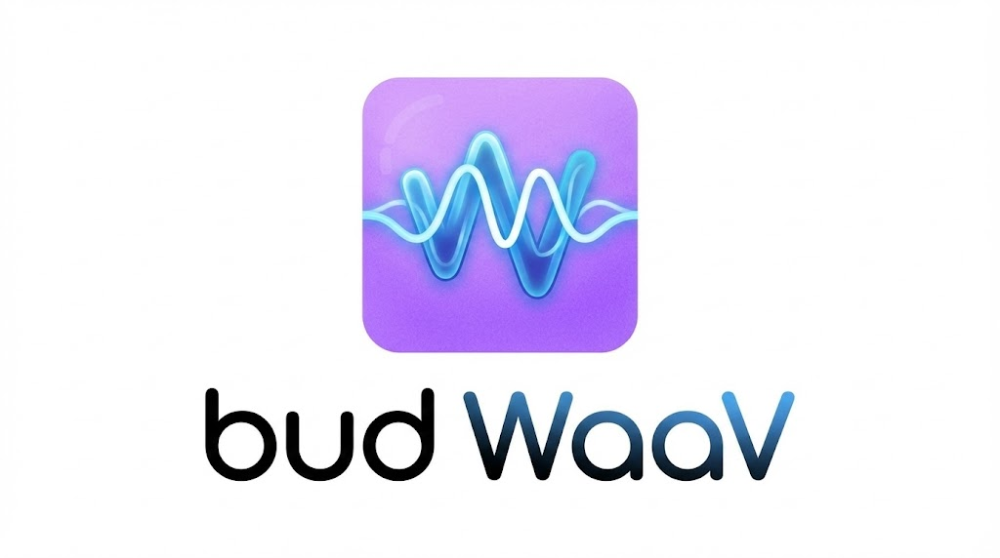
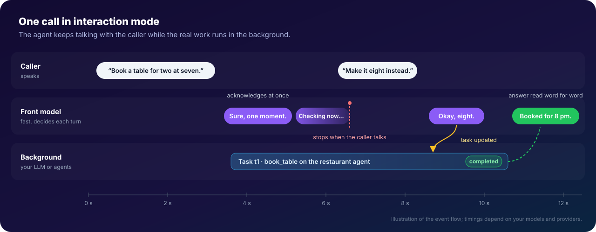
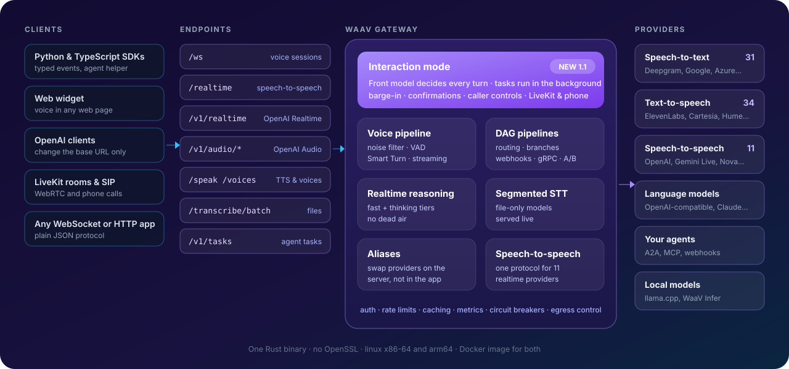

<p align="center">
  
</p>

<h1 align="center">WaaV Gateway</h1>

<p align="center">
  <b>The real-time voice gateway for AI agents.</b><br>
  One API for 70+ speech providers, realtime voice models and your own LLMs.<br>
  Self-hosted, open source, written in Rust. From <a href="https://github.com/BudEcosystem">Bud Ecosystem</a>.
</p>

<p align="center">
  <a href="https://github.com/BudEcosystem/WaaV/releases/latest"></a>
  <a href="https://github.com/BudEcosystem/WaaV/actions/workflows/ci.yml"></a>
  
  
  
</p>

<p align="center">
  <a href="#quick-start">Quick start</a> ·
  <a href="#new-in-11-interaction-mode">What's new</a> ·
  <a href="#features">Features</a> ·
  <a href="#providers">Providers</a> ·
  <a href="#client-sdks">SDKs</a> ·
  <a href="#documentation">Docs</a>
</p>

<p align="center">
  
</p>

WaaV sits between your app and the speech world. Your app streams audio or text to one endpoint; WaaV
transcribes it, runs your agent, speaks the answer and streams it back, with whichever providers you
choose. Swapping Deepgram for ElevenLabs, or a cloud model for your own, is a config change, not a
rewrite.

## Why WaaV

<table>
<tr>
<td width="50%" valign="top">
<h3>🔌 One API, every provider</h3>
31 speech-to-text, 35 text-to-speech and 11 speech-to-speech providers behind one WebSocket and REST
API, plus drop-in OpenAI <code>/v1/audio</code> and <code>/v1/realtime</code> endpoints. Language
codes, voices and emotions are written once and mapped to each provider's own form.
</td>
<td width="50%" valign="top">
<h3>🗣️ Agents that feel like people</h3>
Interaction mode answers at once, keeps the conversation going while slow work runs, stops when the
caller talks over it, and asks before it does anything that matters. Reasoning models stay usable on a
live call.
</td>
</tr>
<tr>
<td valign="top">
<h3>🏭 Built for production</h3>
A single Rust binary with no OpenSSL. Auth, rate limits, caching, circuit breakers, reconnect and replay,
Prometheus metrics, and egress control that keeps every key on its own vendor's hosts.
</td>
<td valign="top">
<h3>🧩 Yours to shape</h3>
Self-hosted and Apache-2.0. Compose pipelines as graphs, rename providers behind aliases, plug in your
own LLMs, agents (A2A, MCP, webhooks) and local models, and reach phones and rooms through LiveKit and SIP.
</td>
</tr>
</table>

## New in 1.1: interaction mode

A voice agent normally goes quiet while it thinks, talks over the caller, and can't take "actually, make it
eight" in the middle of a booking. **Interaction mode** fixes that. A small, fast **front model** reads every
caller turn and replies straight away; the real request becomes a **task** that your LLM, an orchestrator or
your own agents run in the background; the answer is read out word for word when it is ready.

<p align="center">
  
</p>

- **Answers at once, never dead air.** An acknowledgement, progress lines and honest stall lines while tasks run.
- **Real turn-taking.** It tracks who has the floor, ducks under a caller who starts speaking, stops on a real interruption, and backchannels during long turns.
- **Tasks you can follow.** Every request is a task with events on the socket and in `GET /v1/tasks`. Run several at once, follow up on a finished one, or let it finish after the call.
- **Safe actions.** Tools with side effects are read back and confirmed. The caller can answer by voice, on screen or on a keypad.
- **Caller controls.** "Stop", "hold on", "repeat that", "slower", "switch to Spanish", "get me a person".
- **Works where your callers are.** `/ws` sessions, Bud voice agents, speech-to-speech providers, LiveKit rooms and phone calls.

It is opt-in: sessions that don't ask for it behave exactly as before.
→ [Tutorial](gateway/docs/tutorials/interaction_mode_tutorial.md) · [Reference](gateway/docs/interaction_mode.md) · [Changelog](gateway/CHANGELOG.md)

## Quick start

**1. Download and run** (Linux, x86-64 or arm64; [all releases](https://github.com/BudEcosystem/WaaV/releases)):

```bash
ARCH=x86_64   # or aarch64
curl -fsSLO https://github.com/BudEcosystem/WaaV/releases/download/1.1.0/waav-gateway-1.1.0-linux-$ARCH.tar.gz
tar xzf waav-gateway-1.1.0-linux-$ARCH.tar.gz && cd waav-gateway-1.1.0-linux-$ARCH

export DEEPGRAM_API_KEY=your-deepgram-key   # the examples below use Deepgram
./waav-gateway                              # listens on http://localhost:3001
```

**2. Make it speak:**

```bash
curl -s http://localhost:3001/speak -H 'content-type: application/json' \
  -d '{"text": "Hello from WaaV!", "tts_config": {"provider": "deepgram", "audio_format": "linear16", "sample_rate": 24000}}' \
  -o hello.pcm
ffplay -autoexit -f s16le -ar 24000 -ac 1 hello.pcm
```

**3. Stream a conversation.** Open `ws://localhost:3001/ws`, send one `config` message, then stream audio:

```json
{
  "type": "config",
  "stt_config": { "provider": "deepgram", "model": "nova-3", "language": "en",
                  "sample_rate": 16000, "channels": 1, "punctuation": true, "encoding": "linear16" },
  "tts_config": { "provider": "deepgram", "model": "aura-asteria-en", "voice_id": "aura-asteria-en",
                  "audio_format": "linear16", "sample_rate": 24000 }
}
```

You get `ready`, then live `stt_result` transcripts as you send 16-bit PCM frames. Add a `conversation_config`
to have the gateway answer with an LLM, or `"interaction": true` for interaction mode.

<details>
<summary><b>Run with Docker or build from source</b></summary>

```bash
git clone https://github.com/BudEcosystem/WaaV.git && cd WaaV

# Docker (the build context is the repository root)
docker build -f gateway/Dockerfile -t waav-gateway .
docker run -p 3001:3001 -e DEEPGRAM_API_KEY=your-deepgram-key waav-gateway

# From source (Rust stable)
cd gateway && cargo build --release --features dag-routing,turn-ensemble,noise-filter,openapi
./target/release/waav-gateway -c config.example.yaml
```

`waav-gateway check` validates your environment and config file without starting the server.
Build details and gotchas: [docs/build/BUILD.md](docs/build/BUILD.md) · Deployment: [gateway/docs/deployment.md](gateway/docs/deployment.md).
</details>

## What you can build

| You want to… | Use | Start here |
|---|---|---|
| Put a voice agent on a website or app | `/ws` with `conversation_config` (+ `interaction`) | [Tutorial](gateway/docs/tutorials/interaction_mode_tutorial.md) |
| Answer phone calls | LiveKit rooms and SIP | [LiveKit](gateway/docs/livekit_integration.md) · [SIP](gateway/docs/sip_routing.md) |
| Use a speech-to-speech model (OpenAI Realtime, Gemini Live…) | `/realtime` or `/v1/realtime` | [OpenAI Realtime](gateway/docs/openai-realtime.md) |
| Keep your OpenAI client code, change providers | `/v1/audio/*`, `/v1/realtime` | [API reference](gateway/docs/api-reference.md) |
| Live captions and transcription | `/ws` streaming STT, `/transcribe/batch` for files | [WebSocket](gateway/docs/websocket.md) |
| Text-to-speech in any voice | `POST /speak`, `GET /voices` | [API reference](gateway/docs/api-reference.md) |
| A custom pipeline (route, branch, call webhooks) | DAG configs | [DAG routing](gateway/docs/dag_routing.md) |

## Features

| | |
|---|---|
| **Interaction mode** | Front model for every turn, background tasks, barge-in, confirmations, caller controls, personas, caller memory, language packs. [Docs](gateway/docs/interaction_mode.md) |
| **Voice pipeline** | DeepFilterNet noise suppression, Silero VAD, Smart Turn and text turn detection, streaming TTS, Opus transport. |
| **Realtime reasoning** | A fast model for simple turns and a reasoning model for hard ones, with latency masking, a stall watchdog and chain-of-thought never spoken. [Design](docs/research/REALTIME_REASONING.md) |
| **Speech-to-speech** | One protocol for 11 realtime providers, with reconnect, conversation replay and barge-in done once for all. |
| **Segmented speech-to-text** | File-only transcription models served live, turn by turn. [Docs](docs/segmented-stt/customer-contract-reference.md) |
| **DAG pipelines** | Chain STT, LLM and TTS nodes with routing, splits and joins, and HTTP, gRPC and WebSocket endpoints. [Docs](gateway/docs/dag_routing.md) |
| **Aliases** | Name a bundle of providers on the server (`support-bot`) and re-point it without touching clients. [Docs](gateway/docs/aliases.md) |
| **Canonical config** | One language code, one emotion name and one voice description, mapped to each provider's own form. |
| **OpenAI compatible** | `/v1/audio/speech`, `/v1/audio/transcriptions`, `/v1/audio/translations` and `/v1/realtime`. |
| **Security** | API secrets or JWT auth, per-IP rate limits, operator credentials and an egress allowlist. [Auth](gateway/docs/authentication.md) · [Egress](gateway/docs/egress-and-credentials.md) |
| **Operations** | Prometheus metrics, OpenTelemetry tracing, a live latency profiler, recording to S3, graceful drain. |

## Architecture

<p align="center">
  
</p>

## Providers

| Kind | Count | Including |
|---|---|---|
| Speech-to-text | 31 | Deepgram, Google, Azure, OpenAI, ElevenLabs, AssemblyAI, Cartesia, AWS Transcribe, Speechmatics, Gladia, Sarvam, iFlytek… |
| Text-to-speech | 35 | ElevenLabs, Deepgram, Cartesia, OpenAI, Google, Azure, AWS Polly, Hume, Murf, Resemble, Smallest.ai… |
| Speech-to-speech | 11 | OpenAI Realtime, Gemini Live, Deepgram Voice Agent, ElevenLabs agents, Hume EVI, AWS Nova Sonic, Azure, Grok, Inworld, Ultravox, Yandex |
| Language models | any | OpenAI-compatible servers (vLLM, llama.cpp, Ollama…), OpenAI, Anthropic, Gemini |

Regional coverage includes India, China, Japan, Korea, South-East Asia, Russia and Europe.
→ [Every provider, with models and features](gateway/docs/SUPPORTED_PROVIDERS.md)

## Client SDKs

| SDK | Install | Docs |
|---|---|---|
| Python | `pip install "git+https://github.com/BudEcosystem/WaaV#subdirectory=clients_sdk/python"` | [clients_sdk/python](clients_sdk/python/README.md) |
| TypeScript | from a clone: `cd clients_sdk/typescript && npm ci && npm run build`, then `npm install <path-to>/clients_sdk/typescript` | [clients_sdk/typescript](clients_sdk/typescript/README.md) |
| Web widget | a drop-in voice button for any page | [clients_sdk/widget](clients_sdk/widget/README.md) |

A voice agent in Python:

```python
import asyncio
from bud_waav import BudClient

async def main():
    bud = BudClient(base_url="http://localhost:3001")
    agent = bud.agent(
        stt={"provider": "deepgram", "model": "nova-3", "language": "en"},
        tts={"provider": "deepgram", "voice_id": "aura-asteria-en"},
        llm={"base_url": "http://localhost:8000/v1", "model": "your-fast-model"},
        interaction=True,          # the 1.1 interaction mode (needs the server switch)
    )
    async with agent:
        async for event in agent:  # transcripts, audio, interaction events, warnings
            print(event.type)

asyncio.run(main())
```

## API at a glance

| Endpoint | What it does |
|---|---|
| `GET /ws` | Streaming voice session: STT, TTS, LLM loop, DAGs, interaction mode |
| `GET /realtime` · `GET /v1/realtime` | Speech-to-speech, in WaaV's protocol or OpenAI's |
| `POST /speak` · `GET /voices` · `POST /voices/clone` | Synthesis, voice catalogue, voice cloning |
| `POST /v1/audio/speech` · `/transcriptions` · `/translations` | OpenAI Audio API |
| `POST /transcribe/batch` | Transcribe files |
| `GET /v1/tasks` · `GET /v1/tasks/events` | Interaction-mode tasks and their live events |
| `/livekit/*` · `/sip/*` | Rooms, tokens, participants, call transfer |
| `/dag/*` · `/capabilities/*` | Pipeline templates and validation, provider capabilities |
| `GET /livez` · `GET /metrics` | Health and Prometheus metrics |

Full reference: [gateway/docs/api-reference.md](gateway/docs/api-reference.md) · OpenAPI spec: [gateway/docs/openapi.yaml](gateway/docs/openapi.yaml)

## Documentation

| | |
|---|---|
| **Start** | [Interaction mode tutorial](gateway/docs/tutorials/interaction_mode_tutorial.md) · [WebSocket protocol](gateway/docs/websocket.md) · [API reference](gateway/docs/api-reference.md) |
| **Features** | [Interaction mode](gateway/docs/interaction_mode.md) · [DAG routing](gateway/docs/dag_routing.md) · [Aliases](gateway/docs/aliases.md) · [LiveKit](gateway/docs/livekit_integration.md) · [Plugins](gateway/docs/plugins.md) |
| **Operate** | [Deployment](gateway/docs/deployment.md) · [Docker](gateway/docs/docker.md) · [Authentication](gateway/docs/authentication.md) · [Egress and credentials](gateway/docs/egress-and-credentials.md) |
| **Providers** | [Supported providers](gateway/docs/SUPPORTED_PROVIDERS.md) · [Adding a provider](gateway/docs/how_to_add_new_provider.md) |
| **Project** | [Changelog](gateway/CHANGELOG.md) · [Building](docs/build/BUILD.md) · [Design notes, plans and reports](docs/README.md) |

## Contributing

Issues and pull requests are welcome. Before you open a PR, run what CI runs (the build environment, such as
`CUDA_HOME=/tmp/nocuda`, is in [docs/build/BUILD.md](docs/build/BUILD.md)):

```bash
cd gateway
cargo fmt --all --check
cargo clippy --all-targets --features dag-routing,turn-ensemble,noise-filter,openapi -- -D warnings
cargo test --lib --features dag-routing,turn-ensemble,noise-filter,openapi
```

CI runs these plus integration tests against mock providers, accuracy gates for voice activity and turn
detection, an OpenAPI drift check and supply-chain checks.

## License

[Apache-2.0](gateway/LICENSE) © Bud Ecosystem
